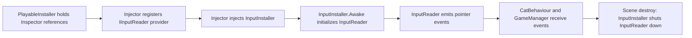
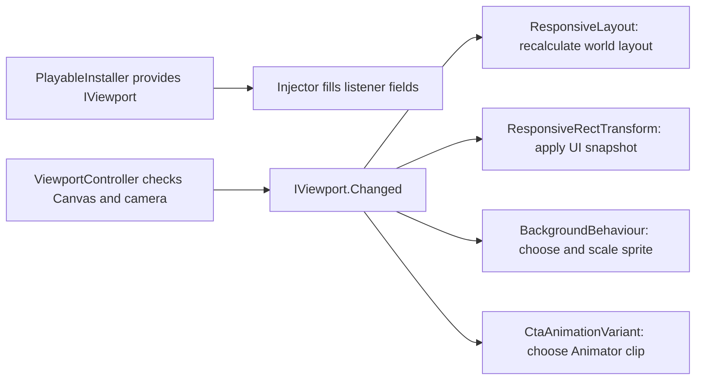
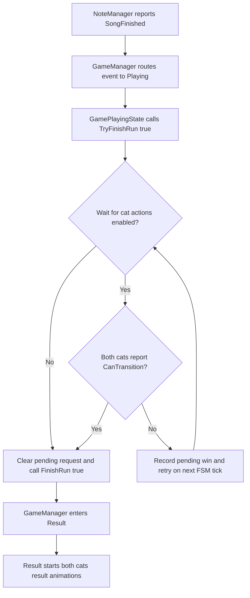
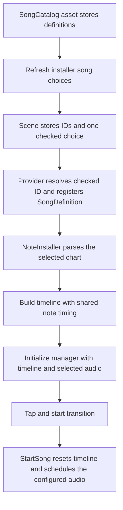
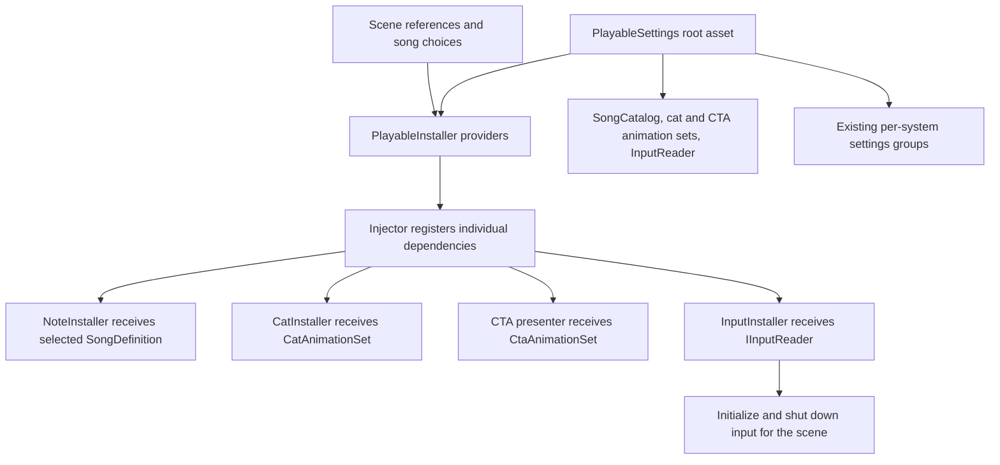
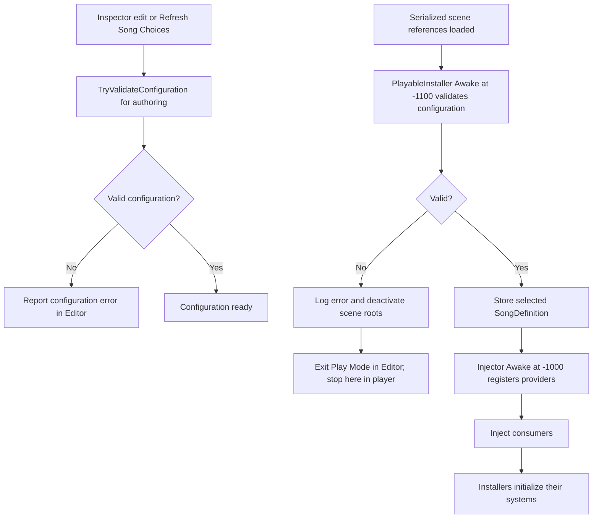
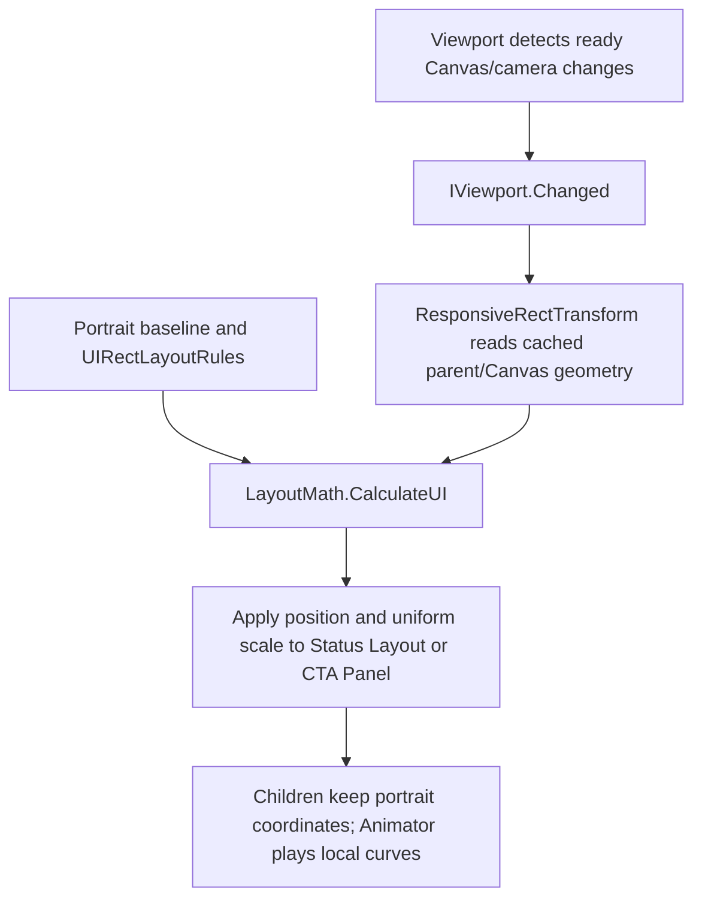

# Step 3 — Refactor Notes

This document records each agreed change by system and file. The implementation sections describe changes already made. The maintainability assessment compares the original and refactored code and labels future extensions explicitly; it does not describe them as implemented. The current runtime flows are in [SYSTEM_FLOWS.md](SYSTEM_FLOWS.md), and the file inventory is in [FILE_REFERENCE.md](FILE_REFERENCE.md).

Sections 12-14 record the intermediate UI snapshots and CTA clip variants. Sections 32-33 replace that setup with portrait-based group rules and remove its unused components/assets after visual review.

The dedicated [UI Layout Calculations](UI_LAYOUT_CALCULATIONS.md) guide explains the overall flow, coordinate units, equations, enum examples and Inspector rule effects for the current responsive UI implementation.

The next stage is [Step 4 — Technical Interview Preparation](STEP4_INTERVIEW_PREP.md): prepare questions about the case study and previous CV projects. Case-study questions use a recorded Main snapshot; this refactor branch supplies improvement ideas and implementation evidence.

## Before and after at a glance

| Change | Before | After | Key improvement | Trade-off |
| --- | --- | --- | --- | --- |
| Scene references and input | `PlayableInstaller` also owned input initialization and shutdown; required references were checked manually. | `InputInstaller` owns the input lifecycle; `PlayableInstaller` supplies references and validates its own and the root asset's serialized Unity object fields before provider registration. | One place for scene wiring and automatic coverage when a required reference is added. | Reflection treats every serialized Unity object field as required; deeper system-specific validation remains with each installer. |
| Note manager wiring | `NoteInstaller` found or added a concrete `NoteManager` on its own GameObject. | `PlayableInstaller` provides the scene manager as `INoteManager`; `NoteInstaller` passes setup dependencies, and the manager gets its own `AudioSource`. | Both installers use the same scene instance; game flow can depend on a mockable contract. | `INoteManager.Initialize()` still includes Unity types, and `[DisallowMultipleComponent]` only checks one GameObject. |
| Score rules | Point values and lookup lived directly in `PlayableSettings`. | Nested `ScoreSettings` implements `IScoreRules` and is supplied to `ScoreManager`. | Scoring rules can be replaced in tests without passing the whole settings asset. | The root asset remains a container, and moving serialized values required an asset YAML migration. |
| Note and hit settings | Note, particle, and hit-text fields shared the root settings class. | `NoteSettings`, `HitVfxSettings`, and `HitTextSettings` own their respective configuration. | Consumers receive the settings relevant to their system. | Presentation settings remain concrete classes; the Inspector still contains several nested groups. |
| Game flow and scene visuals | Timing, layout profiles, and background references were fields on the root settings class. | `GameFlowSettings` and `SceneVisualSettings` group those values; game timing uses `IGameFlowSettings`. | Game logic can receive timing rules independently of visual configuration. | `SceneVisualSettings` remains concrete and shared by layout and background. |
| UI state visibility | Each state UI component interpreted game state and managed its own visibility timing. | `GameUIController` interprets state and delays; `GameStateUI` only applies view changes. | State rules are centralized while panels stay simple. | Controller bindings must be maintained in the scene, and controllers must remain active while panels are hidden. |
| Score manager ownership | Gameplay accessed `ScoreManager.Instance`, and newly pooled notes looked up the singleton. | `PlayableInstaller` provides `IScoreManager`; `GameInstaller` gives it to `GamePlayingState`, and `NoteInstaller` gives it to `NoteManager` for pooled notes. | Dependencies are explicit and the score service is replaceable in tests. | There is more setup wiring; scene-wide duplicate score components are no longer checked by the provider. |
| Loss Animator parameter | `ScoreUI` called `SetBool("Lose", true)` with fixed arguments. | The parameter name and bool value are serialized on `ScoreUI`. | The Animator contract can change in the Inspector without a code edit. | A mistyped parameter name is detected at runtime rather than compile time. |
| Cat animation mapping | `CatClip` and a switch mapped hardcoded clip names; `CatBehaviour` held idle variants. | `CatAnimationSet` stores semantic cues, clip variants, and loop flags; `CatInstaller` validates the asset against both Spine skeletons. | Adding or changing a variant is an asset edit; the one-call `AnimationPlayer` helper is gone. | Clip names are serialized strings, so a typo is reported at setup rather than compile time; the scene needs another asset reference. |
| Cat behaviour separation | `CatBehaviour` also chose and played Spine clips, tracked idle history, and held completion callback versions. | `CatAnimationController` implements `ICatAnimation` for each cat; `CatBehaviour` implements `ICatBehaviour` for runtime interaction and `ICatSetup` for installer setup. | Animation state is isolated per cat, and gameplay and presentation code no longer name the concrete cat component. | `CatInstaller` creates one extra plain-C# object per cat; `ICatSetup` still names concrete Hit/Result states built by that installer. |
| Cat setup split | One `Initialize()` call received the FSM, its event states, the cat action, side, input, and layout. | `ConfigureStateMachine()` receives the FSM and event states; `Initialize()` receives runtime action and scene dependencies. | The setup calls have distinct purposes and match the game installer pattern. | The installer must call them in order, and the FSM setup still names concrete Hit/Result states. |
| Cat input lifecycle | `StopPlaying()` unsubscribed input, while `StartPlaying()` did not reconnect it. A cat remained in Result until scene reload. | `StartPlaying()` ensures an active cat is subscribed; `ICatBehaviour.ResetForRun()` clears drag, returns the FSM to Idle, and reconnects input when active. | An initialized cat can be prepared for reuse in the same scene without rebuilding its action or FSM. | The reset method is an extension point; the game flow does not yet call it or implement complete same-scene replay. |
| Winning Result readiness | Song completion immediately entered Result and could replace the last cat hit animation. | States expose advisory `CanTransition()` readiness; `GamePlayingState` can wait for both cats before completing a win. | The last hit can finish using its actual completion callback, without a fixed delay or animation details in game flow. | Waiting depends on completion being reported; no timeout is added. Losses and explicitly requested FSM transitions remain immediate. |
| Hit particle emission | `CatHitVfx` calculated angle, velocity, random speed, and gradient position for every particle before calling `Emit()` in a loop. | Prefab Shape/Burst modules emit the particles; profiles supply count, lifetime, size, a Unity speed curve, and start colors. | VFX direction is authored in Unity, while code only selects and applies note-specific data. | The prefabs require one configured burst; Lolipop colors are randomly selected instead of correlated with particle angle. |
| Responsive layout contract | Note and cat code depended directly on the `ResponsiveLayout` component. | `IResponsiveLayout` exposes the layout snapshot, change event, recalculation, and screen-to-world conversion; the installer provides the scene component through that interface. | Gameplay consumers can substitute a layout implementation without constructing the Unity component. | The contract still includes both note placement and cat input needs; it may be split if these evolve independently. |
| Note timeline contract | `NoteManager` constructed a concrete `NoteTimeline` whenever a song started, and `NoteBehaviour` called its static position helper. | `NoteInstaller` builds the timeline and passes it as `INoteTimeline`; `StartSong()` resets the cursor, and `NoteBehaviour.Place()` uses the interface's `GetY()`. | Playback and note placement no longer name the concrete timeline. | One timeline instance requires a reset before each run; note collision and scoring remain separate review targets. |
| Configurable cat layer for note hits | `NoteBehaviour.Awake()` resolved the hardcoded `"Cat"` layer. | `NoteSettings.CatLayerName` flows through the installer, manager, and pool into each note; the installer validates the layer. The collision lookup uses `ICatBehaviour`. | Collision filtering and the cat implementation can change without editing note code. | The layer name travels through several setup constructors; the collider still needs a component implementing the cat contract on its GameObject. |
| Note behaviour contract | The pooled note component exposed gameplay methods only through its concrete class. | `INoteBehaviour` names its note data and placement methods; `NoteBehaviour` implements it separately from `IPoolObject<NoteBehaviour>`. | Gameplay and pool contracts are explicitly distinct. | Pool setup remains a concrete Unity boundary. |
| Note pool ownership | `NoteManager` constructed `NotePool`, held concrete active notes, and cleared the pool on destruction. | `NoteInstaller` constructs and clears the concrete pool; `NoteManager` receives `INotePool` and keeps `INoteBehaviour` instances. | Playback orchestration no longer depends on the concrete note or pool classes. | The pool adapter checks the concrete type when releasing a note; Unity prefab creation remains concrete. |
| Responsive gameplay layout | One `Utility/ResponsiveLayout.cs` held scene updates, calculated layout data, and all layout math. | `UI/ResponsiveLayout.cs` coordinates world-space layout; `UI/LayoutMath.cs` calculates coordinates; `Settings/LayoutData.cs` carries the result. The component recalculates on viewport events. | Geometry is separate from the Unity component; one viewport event keeps cat and lane positions in sync. | World-space placement and input coordinate conversion still share the scene component. |
| Canvas layout variants | UI `RectTransform`s had no reusable portrait/landscape profile. | `ResponsiveRectTransform` applies a portrait baseline plus `UIRectLayoutRules` to Status Layout and CTA Panel; `LayoutMath.CalculateUI()` calculates the group layout. | One authored composition adapts across ratios, while child animation stays in its local space. | Bounds and margins still need authoring; a separate landscape composition would need additional rules. |
| Shared viewport events | Layout, background, and UI components independently checked the Canvas or camera, called `Refresh()` on the viewport, or searched for it in parents. | `ViewportController` samples Canvas/camera changes and publishes `IViewport.Changed`. The installer provides `IViewport`; runtime consumers inject it, subscribe once, and apply the current snapshot once. | One component detects changes; consumers have explicit dependencies and no longer force repeated viewport checks. | The controller still checks once per frame, with an early return when nothing changed. Edit-mode previews need a local scene reference because injection runs only in Play Mode. |
| CTA animation sizing | One CTA clip could key card sizes that fit portrait but overflow in landscape. | The original clip animates the children; the CTA group fits available Canvas space and caps landscape scale. The intermediate variant scripts/asset/clip were removed in Section 33. | One clip works across ratios without maintaining a duplicate orientation clip. | Changing animation peaks or child positions requires reviewing the group's configured bounds. |
| Cat hit animation mix | All cat cues used Spine's 0.2-second default mix, which could soften the start of short hit clips. | `CatAnimationSet` supplies a mix duration per cue; HitNormal/HitOther use 0.03 seconds, and the other cues use 0.2 seconds. | Hit responsiveness can be tuned in the animation asset without changing gameplay timing or clip speed. | This is a visual tuning experiment; each destination cue has one mix value for all incoming transitions. |
| Song and chart selection | `NoteSettings` held one audio and one JSON; the chart was parsed at startup while audio was read on each start. | A shared `SongCatalog` SO owns the definitions; each `PlayableInstaller` stores only IDs and selection checkboxes. `NoteInstaller` receives the selected definition and supplies its audio and timeline together to the manager. | Scenes share reusable song data while choosing their own variant through the normal Inspector. | Song choices need a refresh after editing the catalog, and exactly one choice must be checked. Runtime switching and complete A/B tracking remain separate work. |
| Song playback configuration | AudioSource play-on-awake, loop, and spatial blend were fixed values in `NoteManager`. | Each catalog definition stores those values and implements `ISongPlaybackSettings`; the manager applies that contract during initialization. | Playback configuration is authored with the song, and manager setup does not need its ID or JSON. | These are AudioSource settings; autoplay and looping the complete chart/session require separate flow decisions. |
| Shared asset references | The scene installer held settings, catalog, both animation sets, and input as separate references. | `PlayableSettings` references the catalog, cat animation set and input asset; `PlayableInstaller` provides them through its single settings reference and keeps scene-specific song choices. The retired CTA set reference/provider was removed in Section 33. | Shared configuration can be assigned together while consumers retain their existing dependency contracts. | Editing a shared settings asset affects every scene using it; separate configurations need separate settings assets. |
| Invalid song selection | A missing or multiple selection threw during provider registration, leaving scene components without injected dependencies. | `PlayableInstaller` shares private configuration validation between Inspector checks and its early `Awake()`. Invalid setup stops the scene before Injector runs. | A forgotten checkbox produces a configuration error; the generic injection utility stays focused on registration and injection. | Playable validation relies on its `Awake()` running before Injector; the failure policy deactivates the scene until configuration is fixed and restarted. |
| Exclusive song checkboxes | Switching songs required manually clearing the previous checkbox. | Editor validation recognizes one newly checked song ID and clears the other choices. | Selecting a variant is one click for any catalog size, using the standard Inspector. | The Editor keeps transient selection history; unknown or ambiguous multiple selections still require validation instead of guessing. |

## 1. Scene references and input lifecycle

### Decision

Keep `PlayableInstaller` as the single Inspector reference holder and `[Provide]` source. Keep the current `Injector`. Move ownership of the input action callbacks to a focused `InputInstaller` supplied with `IInputReader` through `[Inject]`.

### File-by-file changes

| File | Change | Reason |
| --- | --- | --- |
| `Assets/Script/Installer/PlayableInstaller.cs` | Removed `IInstaller`, the empty `StartInitialize()`, and direct `InputReader.Initialize()/Shutdown()` calls. Kept all serialized references and `[Provide]` methods. `Awake()` and Editor `OnValidate()` call `ValidateReferences()`, which scans serialized Unity object fields and reports their missing names. | This class provides references but no longer owns the input lifecycle. New serialized object references are included in validation automatically. |
| `Assets/Script/Installer/InputInstaller.cs` | Added `[Inject] IInputReader`. `Awake()` initializes it; `OnDestroy()` shuts it down. | One scene component now owns both ends of the input lifecycle. Existing `InputReader` behavior and its idempotent `Initialize()` remain unchanged. |
| `Assets/Script/Installer/InputInstaller.cs.meta` | Added a stable Unity GUID for the new script. | The scene component keeps its script reference across imports and clones. |
| `Assets/Scenes/Case Study Scene.unity` | Added `InputInstaller` to the existing `PlayableInstaller` GameObject. | The new lifecycle owner is active in the playable scene without manual Inspector setup. |

`Injector` still runs early with execution order `-1000`, registers `PlayableInstaller` providers, and injects `IInputReader` before `InputInstaller.Awake()`. `CatInstaller` and `GameInstaller` build their respective FSMs after injection. The `IInstaller` interface remains in use by all three installers.

### Resulting startup flow

### Validation and limits

- `PlayableInstaller.OnValidate()` reports missing fields in the Editor; `Awake()` checks again at runtime. Every `[SerializeField]` field whose type derives from `UnityEngine.Object` is treated as required. An optional reference would need an explicit opt-out rule.
- Because `Injector.Awake()` runs before `PlayableInstaller.Awake()`, a missing `[Provide]` reference may first be reported by `Injector`. The Editor check makes this easier to catch before Play mode.
- No gameplay state, note scheduling, scoring, or pointer interpretation was changed in this step.

## 2. NoteManager wiring

Added `[DisallowMultipleComponent]` to `Assets/Script/Behaviour/Notes/NoteManager.cs` to prevent duplicates on one GameObject. `NoteManager` implements `INoteManager`, whose contract includes `Initialize()`, `StartSong()`, `StopSong()`, `NoteMissed`, and `SongFinished`. `PlayableInstaller` keeps the concrete scene reference but provides it as `INoteManager`; `NoteInstaller`, `GameInstaller`, and `GameManager` use that interface.

`NoteInstaller` validates the prefab, song, chart, and timing, parses the chart, constructs the timeline and pool, then passes `INoteTimeline`, `INotePool`, `INoteSettings`, and `IResponsiveLayout` to `INoteManager.Initialize()`. The installer supplies the manager's transform as the pool parent; the manager gets or adds its own `AudioSource`. This connects both installers to the same note system without exposing a `GameObject` through the interface. `[DisallowMultipleComponent]` applies per GameObject; no scene-wide uniqueness check was added for notes.

## 3. Score rules pilot

Extracted score values and `GetPoints(NoteVisualType)` into the serializable `ScoreSettings` class, which implements `IScoreRules`. The existing `PlayableSettings` asset still holds the values in one Inspector, now under its `score` field. Its saved values (2, 5, 10, 10) were copied into the nested field when migrating the asset YAML.

`PlayableInstaller` provides `IScoreRules` from that object. `ScoreManager` receives the interface through a private `[Inject]` field; tests can replace it with a fake through their injection tooling. `ScoreUI`, `ScoreChanged`, and the score reset flow are unchanged. The score pilot initially left other settings in `PlayableSettings`; the following step extracts note and hit settings.

## 4. Note and hit settings

`PlayableSettings` remains the single Inspector asset, but now embeds three serializable groups: `NoteSettings`, `HitVfxSettings`, and `HitTextSettings`. The existing asset values and references were moved into `notes`, `hitVfx`, and `hitText` respectively. This includes the chart/song, all note sprites and radii, particle profiles and gradient, and the hit-text font and words.

| File | Change | Reason |
| --- | --- | --- |
| `Settings/INoteSettings.cs` | Defines the chart, song, timing, sprite, and radius contract. | Note setup and playback can receive a fake without depending on the whole asset. |
| `Settings/NoteSettings.cs` | Implements `INoteSettings` and owns the note-related serialized fields and selection methods. | Keeps note rules together and removes them from the root settings class. |
| `Settings/HitVfxSettings.cs` | Owns particle profiles, left/right colors, gradient, and Unity speed curves. | Groups note-specific visual effect tuning in one Inspector foldout; Shape configuration lives in the particle prefabs. |
| `Settings/HitTextSettings.cs` | Owns the font, words, color, size, and timing of the hit label. | Groups text presentation separately from note rules and VFX. |
| `Installer/PlayableInstaller.cs` | Provides `INoteSettings`, `HitVfxSettings`, and `HitTextSettings` from the same asset. | Consumers receive only the settings group they use. |
| `Installer/NoteInstaller.cs`, `Behaviour/Notes/NoteManager.cs` | `NoteInstaller` receives `INoteSettings` through a private `[Inject]` field, uses it to validate and parse the chart, then passes it to `NoteManager.Initialize()`. The manager stores it in a regular private field. Note scheduling and hit/miss behavior stay the same. | The installer already needs these settings, so one handoff avoids injecting the same dependency twice. Both classes still depend on the narrow interface rather than the entire asset. |
| `Behaviour/Cat/CatHitVfx.cs`, `Behaviour/Cat/CatHitText.cs` | Receive their respective concrete settings groups. | These presentation components do not currently need a separate mockable rule contract. |
| `Assets/Scriptable Object/Settings/PlayableSettings.asset` | Moved existing serialized values under the new nested fields. | Preserve the scene's tuning and asset references after changing the C# field layout. |

At this stage, game flow, layout, and background still used `PlayableSettings`; the next step separates them too.

## 5. Game flow and scene visuals

The remaining fields in `PlayableSettings` were divided into two serializable classes while keeping one Inspector asset:

| File | Change | Reason |
| --- | --- | --- |
| `Settings/GameFlowSettings.cs` | Owns start-transition, result, and CTA-reload durations; exposes them through `IGameFlowSettings`. | `GameManager` can receive a fake timing configuration without depending on the entire asset. The UI controller shares the same start-transition duration. |
| `Settings/SceneVisualSettings.cs` | Owns portrait/landscape `LayoutProfile` values and background sprites. | Layout and background select the same screen orientation and can be tuned in one group. |
| `Settings/PlayableSettings.cs` | Embeds `gameFlow` and `sceneVisuals` and exposes them through properties. | The root asset now groups settings without owning each system's fields. |
| `Installer/PlayableInstaller.cs` | Provides `IGameFlowSettings` and `SceneVisualSettings`. Its `SceneVisuals` property also supports Edit-mode layout previews. | Consumers no longer need a root `PlayableSettings` injection. |
| `Installer/GameInstaller.cs`, `Control/Game/*State.cs`, `Behaviour/GameManager.cs`, `UI/GameUIController.cs` | Use `IGameFlowSettings` for timing. | Keep game-state logic separate from visuals and other configuration. |
| `UI/ResponsiveLayout.cs`, `Behaviour/BackgroundBehaviour.cs` | Use `SceneVisualSettings`; `LayoutMath.Calculate()` takes its `LayoutProfile`. | Both components read only orientation-related data. |
| `Assets/Scriptable Object/Settings/PlayableSettings.asset` | Moved existing timing, layout profiles, and background references under `gameFlow` and `sceneVisuals`. | Preserve the configured playable values. |

The serialized leaf values match the pre-refactor asset. Unity Editor import and Play Mode still need to confirm the nested settings deserialize and the scene runs as expected.

## 6. UI state visibility

`GameStateUI` is now a view: it changes CanvasGroup alpha, active state, and raycast blocking through `Show()`, `Hide()`, `SetAlpha()`, and `SetBlocksRaycasts()`. It does not read `GameState` or start coroutines.

`GameUIController` owns the list of panel bindings, their visible states, show delays, and the Start transition fade. It listens to `IGameState` and uses `IGameFlowSettings.StartTransitionSeconds`. `GameManager` implements `IGameState`; `PlayableInstaller` provides it for UI listeners and provides `IGameHost` for game-state transitions. `GameInstaller` calls `ConfigureStateMachine()` and `Initialize()` through `IGameState`, while `ScoreUI` reads state and outcome through it. `GameManager` continues to publish `StateChanged` and `StartTransitionBegan`.

The scene Canvas has a controller for Start Tutorial, Status Panel, Scores, EndTutorial, and CTA Panel. The brown cat prefab root has a controller for its Start bubble, because that view belongs to the prefab. The existing visibility rules and delays were moved to these controllers: Status Panel remains visible in Playing/Result with a 2-second initial delay, and CTA Panel appears 3 seconds after Cta. Start Tutorial and the bubble fade when `StartTransitionBegan` fires.

The controllers must stay active while their child panels are hidden so delayed reveals can complete. The UI animation clips remain scene-authored; the later `ScoreUI` parameter change is recorded below. Unity Editor import and Play Mode should verify the migrated scene and prefab bindings.

## 7. ScoreManager without a singleton

`ScoreManager` now inherits `MonoBehaviour`, implements `IScoreManager`, and has `[DisallowMultipleComponent]`. The existing scene component is referenced by `PlayableInstaller`, which provides it as `IScoreManager` through a one-line provider. `ScoreManager` still receives `IScoreRules` through a private `[Inject]` field; no consumer calls `ScoreManager.Instance`.

`GameInstaller` receives `IScoreManager` and passes it to `GamePlayingState`; `NoteInstaller` passes the same interface to `NotePool` for newly created notes. `ScoreUI` receives `IScoreManager` through `[Inject]`, subscribes to `ScoreChanged`, and reads `Score` when refreshing. `GamePlayingState` resets the score when the song has started successfully and the FSM enters Playing. The score rules, point values, event, and reset timing are unchanged.

Notes are created by `NotePool` after the injector has scanned the scene. `NoteInstaller` passes the score reference to the pool, which calls `NoteBehaviour.Initialize(pool, score, catLayerName)` for each new instance. `Initialize()` calls `SetPool(pool)` for the existing `IPoolObject<T>` contract and stores the score reference. `[DisallowMultipleComponent]` prevents duplicate `ScoreManager` components on one GameObject; the provider no longer scans the scene for duplicates.

## 8. Configurable loss animation parameter

`ScoreUI` still triggers the status Animator only when `IGameState` enters a losing `Result`. Its Animator bool parameter name and value are now serialized fields (`Lose` and `true` by default) instead of arguments hardcoded in `SetBool()`. This keeps the animation decision in the scene while allowing the parameter to be changed from the Inspector.

## 9. Data-driven cat animation mapping

**Before:** `AnimationPlayer` switched over `CatClip` to return hardcoded Spine names. `CatBehaviour` contained the idle clip array and selected variants in code. Adding a clip required changing the mapping and possibly the selection logic.

**After:** `CatAnimationSet.asset` groups clips by `Idle`, `Playing`, `HitNormal`, `HitOther`, `Win`, and `Lose`. Each group has its loop flag and one or more Spine clip names. `PlayableInstaller` provides this asset to `CatInstaller`; the installer checks that every cue exists and each clip name exists in both cats' skeleton data before building their FSMs. The asset chooses a clip for `CatAnimationController`, which calls Spine's `SetAnimation()` with that name and loop flag. The scene references the new asset; the single-call `AnimationPlayer` helper was removed.

**Key improvement:** Clip choices and loop behavior can be tuned in the Inspector without editing a switch. Both cats share one configuration without sharing mutable playback state; the idle selection still avoids immediately repeating the previous variant.

**Trade-off:** Serialized string names lose compile-time checking. Setup validation catches missing names and duplicate or missing cues, but a bad asset still prevents a cat from being built at runtime. The extra ScriptableObject and scene reference must be kept together.

## 10. Cat behaviour and animation responsibilities

**Before:** `CatBehaviour` implemented `ICatAnimation` itself. Alongside input, movement, FSM transitions, and hit events, it held Spine and `CatAnimationSet`, chose clips, remembered the last idle variant, and guarded animation completion callbacks. `CatInstaller` had to call `SetupAnimation()` before building the FSM because the initial Idle state plays immediately.

**After:** `CatAnimationController` is a plain C# object implementing `ICatAnimation`. `CatInstaller` creates one controller per cat from its Spine component and the shared animation asset, then passes it to the four cat states before building the FSM. The controller owns clip choice, per-cat idle history, Spine playback, and callback versioning. `CatBehaviour` no longer references Spine or animation settings. It implements `ICatBehaviour` for runtime hit, play/result, visibility, side, and `NoteHit` access, plus `ICatSetup` for `ConfigureStateMachine()` and `Initialize()`. `CatInstaller` checks Unity components through the scene `Transform` and calls only `ICatSetup`; `GameInstaller`, note collisions, hit text, and hit VFX look up `ICatBehaviour`.

**Key improvement:** Animation playback has one owner, while `CatBehaviour` coordinates gameplay and movement. The eager FSM startup remains unchanged because the animation controller is ready before `Build()` enters Idle. Other consumers can depend on `ICatBehaviour` rather than on the component class.

**Trade-off:** The installer now wires an additional object for each cat. `ICatSetup.ConfigureStateMachine()` still names concrete Hit/Result states, and `Initialize()` still takes input/layout dependencies. Unity still requires a concrete `SkeletonAnimation` component at the installation boundary.

## 11. Responsive gameplay layout separation

**Before:** `Utility/ResponsiveLayout.cs` contained the scene component, nested `LayoutData`, and the pure `LayoutMath` calculator. `NoteBehaviour.Place()` named the nested type, so its data dependency also pointed at the component.

**After:** `Settings/LayoutData.cs` holds the immutable, calculated world-space coordinates and lane/clamp helpers. `UI/LayoutMath.cs` calculates that data from camera numbers and a `SceneVisualSettings.LayoutProfile`. `UI/ResponsiveLayout.cs` receives `IViewport`, calls `RecalculateLayout()` when the viewport changes, applies cat positions, emits its own `Changed` event for gameplay consumers, converts input coordinates, and draws gizmos. `NoteBehaviour.Place()` accepts `LayoutData` directly. The original `ResponsiveLayout.cs.meta` GUID moved with the component, preserving the scene reference.

**Key improvement:** The math and its output no longer live inside the Unity component. `RecalculateLayout()` and the gizmo preview share one calculation path. `CatInstaller` and `NoteInstaller` also call `RecalculateLayout()` during startup; its cached result makes a duplicate call a no-op.

**Trade-off:** `ResponsiveLayout` still owns world-space cat placement and input coordinate conversion. Canvas `RectTransform` variants use a separate component so the two coordinate systems stay separate.

## 12. Canvas RectTransform variants

**Before:** Canvas elements had one authored `RectTransform` layout. Animated CTA card sizes were written by the same clip in both orientations.

**After:** `UIRectLayout` stores anchors, pivot, anchored position, size delta, local rotation, and scale. Each `ResponsiveRectTransform` stores portrait and landscape snapshots. It receives `IViewport` through injection at runtime, listens to `Changed`, and applies the matching snapshot when enabled or when orientation changes. Its context menus capture either layout and reapply the current one. Edit-mode preview gets the parent `ViewportController` because the injector does not run there. The scene now has authored variants on selected Status and CTA elements; the user controls their values in the Inspector.

**Key improvement:** UI variants and gameplay geometry react to the same viewport state. Each UI element changes only on orientation changes, so manual Inspector edits are preserved until the next switch.

**Trade-off:** Every responsive element needs two maintained snapshots. If an Animator keys the same `RectTransform`, it can overwrite the snapshot; use an unanimated wrapper or separate clips for that animated property.

## 13. Central viewport publisher

**Before:** Multiple consumers checked the Canvas or camera independently. Some subscribers found `IViewport` by walking parents and called its `Refresh()` after subscribing, duplicating work already done by the viewport and by their own initial update.

**After:** `ViewportController.Initialize()` caches the root Canvas and camera once. `CheckViewport()` runs on enable and in one `Update()` loop; it compares Canvas size plus camera pixel rect, aspect, orthographic size, and position. When any value changes, it updates `IsPortrait` and emits `IViewport.Changed`. `PlayableInstaller` provides that interface to `ResponsiveLayout`, `ResponsiveRectTransform`, `BackgroundBehaviour`, and `CtaAnimationVariant`. Each listener subscribes, applies the current snapshot once if available, then unsubscribes when disabled. `IViewport` no longer exposes `Refresh()`.

**Key improvement:** Change detection has one owner. The initial snapshot read covers listeners that enable after the first event. Runtime listeners do not search the hierarchy or ask the viewport to check again.

**Trade-off:** The controller still performs one comparison per frame to catch phone rotation and camera changes. `ResponsiveLayout` and `ResponsiveRectTransform` retain a small Edit-mode reference path for scene previews because runtime injection is unavailable there.

## 14. CTA animation clips by orientation

**Before:** One CTA animation could write the portrait card dimensions again after the landscape layout was applied.

**After:** `CtaAnimationSet` stores a portrait clip and a landscape clip. `PlayableInstaller` provides the asset; `CtaAnimationVariant` injects both the asset and `IViewport`, creates an `AnimatorOverrideController`, and selects the matching clip on enable and on viewport changes. Both clips use the existing Animator controller and its state machine.

**Key improvement:** Portrait and landscape can use different card sizes while retaining the same animation sequence.

**Trade-off:** The two clips must keep equivalent animation bindings and timing. The configured portrait clip must exist in the original Animator controller so it can be replaced reliably.

## 15. Game flow with the shared FSM

**Before:** `GameManager` stored the Start and Result deadlines, switched `GameState` directly, handled the Playing outcome, and scheduled CTA reload. It also received both cats and the score manager through `Initialize()`.

**After:** `GameInstaller` resolves the scene cats and builds `GameStartState`, `GamePlayingState`, `GameResultState`, and `GameCtaState` with the existing `StateBuilder<GameState>`. It passes the FSM and event-handling states to `GameManager.ConfigureStateMachine()`, then calls `Initialize()` with the runtime note, input, and timing dependencies. The states own their timing and state-specific effects. `GameManager` subscribes to input and note events, routes each event to the active state, ticks the FSM with unscaled time, and forwards transitions through its existing `StateChanged` event. `IGameHost` lets states request transitions and scene-level events without referencing the component class. The shared FSM implementation was not changed.

**Key improvement:** Game and cat FSMs follow the same installer composition pattern. Additional game states can be registered in `GameInstaller` without adding their construction logic to `GameManager`. The UI still reads `IGameState` and receives the same transition notifications.

**Trade-off:** `GameManager` retains the small input/note-event dispatch and the scene-reload coroutine. A new state that responds to a new kind of event may still need a routing change there. `IGameState.ConfigureStateMachine()` currently names the concrete event-handling states; a smaller setup bundle could replace those parameters if the list grows.

## 16. Separate cat FSM configuration from runtime initialization

**Before:** `CatInstaller` passed the FSM, Hit/Result states, cat action, left/right flag, input, and layout into one `CatBehaviour.Initialize()` call. That method stored both the state-machine references and runtime dependencies, then subscribed to input when the component was enabled.

**After:** Once it builds the cat's states, `CatInstaller` calls `ICatSetup.ConfigureStateMachine(fsm, hitState, resultState)`, followed by `ICatSetup.Initialize(action, left, input, layout)`. The first method stores only the FSM and its event-handling states. The second stores the action and scene dependencies and performs the existing input subscription. `ICatBehaviour` contains only the runtime operations used by game flow, note collisions, and cat presentation components.

**Key improvement:** The two setup steps have clear responsibilities and follow the same order as `GameManager`: configure the FSM, then initialize runtime dependencies. This makes the long original parameter list easier to read and leaves room to change cat input or movement wiring without changing FSM construction.

**Trade-off:** Setup now requires two ordered calls. `ConfigureStateMachine()` still references concrete Hit/Result state types, and `CatBehaviour` still coordinates input, movement, and hit notifications.

## 17. Wrap responsive gameplay layout with an interface

**Before:** `NoteManager.Initialize()`, `INoteManager`, `NoteInstaller`, `CatBehaviour.Initialize()`, `ICatBehaviour`, and `CatInstaller` named the concrete `ResponsiveLayout` component. `PlayableInstaller` provided that concrete type.

**After:** `ResponsiveLayout` implements `IResponsiveLayout`. The interface exposes `Current`, `Changed`, `RecalculateLayout()`, and `ScreenToWorldX()`—the members used by note placement, installer setup, and cat input. `PlayableInstaller` provides the same scene component as `IResponsiveLayout`; the consumers above now depend on that contract. Its serialized Inspector reference remains a `ResponsiveLayout` so the scene can assign the component.

**Key improvement:** Note and cat gameplay code can receive a substitute layout in tests without requiring the scene component. This changes wiring only; layout calculation and viewport reactions stay in `ResponsiveLayout`.

**Trade-off:** `Changed` must remain public because `CatBehaviour` subscribes to it to cancel an active drag when the layout changes. The interface serves both note placement and cat input; smaller consumer-specific contracts are possible if those needs diverge.

## 18. Provide the note timeline through an interface

**Before:** `NoteInstaller` parsed the chart and passed its `NoteEvent[]` to `NoteManager`. `NoteManager.StartSong()` created a concrete `NoteTimeline` for each run, making song orchestration depend on that implementation.

**After:** `NoteTimeline` implements `INoteTimeline`, which exposes `TravelSeconds`, `IsDone`, `TryTakeDue()`, `Reset()`, and `GetY()`. `NoteInstaller` creates the timeline after parsing the chart and passes the interface to `INoteManager.Initialize()`. `NoteManager` stores the interface and calls `Reset()` after stopping the previous run, so each start begins at the first chart entry without constructing a new timeline. `NoteBehaviour.Place()` receives the same interface and asks it for Y using the timeline's travel time.

**Key improvement:** The installer owns timeline construction, matching the existing installer pattern for game and cat FSMs. `NoteManager` and `NoteBehaviour` can use a substitute timeline when testing spawn, placement, miss, and completion behavior.

**Trade-off:** A single timeline instance now needs an explicit `Reset()` before each run. `NoteBehaviour.Place()` takes the timeline interface to calculate its position; its collision and scoring responsibilities remain for the note behaviour review.

## 19. Configure the cat layer used by note collisions

**Before:** `NoteBehaviour.Awake()` called `LayerMask.NameToLayer("Cat")`. Renaming the cat layer required changing the behaviour source.

**After:** `NoteSettings` exposes `CatLayerName` through `INoteSettings`; the existing `PlayableSettings` asset stores `Cat`. `NoteInstaller` rejects an empty or unknown name and passes it into `NotePool`, which supplies it once to each new `NoteBehaviour.Initialize()` call. The note resolves the name to a layer number at that point and compares the collider's layer before looking for `ICatBehaviour`.

**Key improvement:** The collision layer is configured with the note rules and validated during setup rather than hidden in note code.

**Trade-off:** The pool carries the layer name to newly created notes. The physics boundary still needs a Unity component lookup and the note still calls `IScoreManager` after a hit.

## 20. Separate note gameplay and pool contracts

**Before:** `NoteBehaviour` implemented only `IPoolObject<NoteBehaviour>`. Its note data, initialization, and placement methods were available solely through the concrete component type.

**After:** `INoteBehaviour` declares `Note`, `HasNote`, `SetNote()`, and `Place()`. `NoteBehaviour` implements it alongside, not through, `IPoolObject<NoteBehaviour>`. The latter continues to own `SetPool()`, `ResetForReuse()`, and `Release()`; none of those methods are repeated in `INoteBehaviour`. Pool-only `Initialize()` remains on the concrete component.

**Key improvement:** The two contracts describe distinct responsibilities and can evolve independently. The note pool now returns `INoteBehaviour` to gameplay code.

**Trade-off:** `NotePool` and its prefab setup still use `NoteBehaviour`, as Unity must instantiate a component. The note's own hit path still calls `Release()` through its concrete pool field.

## 21. Move note pool construction to the installer

**Before:** `NoteManager.Initialize()` accepted a concrete note prefab and score manager, constructed `NotePool`, and kept `List<NoteBehaviour>`. It called `GetPool().Get()` to spawn, `note.Release()` on miss or stop, and cleared the concrete pool in `OnDestroy()`.

**After:** `PlayableInstaller` provides the already assigned NoteManager transform as the note parent. `NoteInstaller` receives it through injection and creates `NotePool` from that parent, the prefab, score manager, and configured cat layer. Moving the installer component will not silently move spawned notes. The installer passes the pool as `INotePool` and owns its cleanup. `NoteManager.Initialize()` receives that interface and keeps `List<INoteBehaviour>`. It calls `INotePool.Get()` for spawn and `INotePool.Release()` for misses or stopping. `NotePool` adapts those calls to the existing `Pool<NoteBehaviour>` and remains the only place that names the concrete prefab type during allocation.

**Key improvement:** `NoteManager` handles song timing and active-note decisions without constructing the pool or depending on `NoteBehaviour` and `NotePool`. A substitute pool can supply test notes through `INoteBehaviour`.

**Trade-off:** `NotePool.Release()` checks that a returned note is a `NoteBehaviour` before forwarding to its existing `Release()` method. Collision-driven hits still release themselves through the underlying Unity pool. `INotePool` does not expose cleanup because the installer owns the concrete pool lifetime.

## 22. Maintainability and playable-variant readiness (assessment only)

This section compares the original case-study snapshot (`8a1dfad`) with the current implementation. The later pre-refactor commit `0f9edb4` added code comments and newline cleanup without changing the runtime logic. This section records an assessment, not another code change. `NoteManager` remains a cohesive per-song coordinator: it starts and stops audio, schedules and positions notes, handles misses, and reports song completion. Splitting it further would not by itself make playable variants easier to produce.

| Review area | Before Step 3 | After Step 3 | Remaining limit |
| --- | --- | --- | --- |
| One playable, repeated tuning | A JSON chart, object pool, DSP-based song timing, state events, cat FSM, and one `PlayableSettings` asset already supported a focused prototype. | The same gameplay loop remains; settings are grouped by system, and dependencies are supplied through narrower contracts. | Both versions still require checking scene asset references and the exported build. |
| Score, note, and game-flow changes | Systems read the large `PlayableSettings` type; `ScoreManager` was a singleton, and `GameManager` named concrete cats and notes. | `IScoreRules`, `INoteSettings`, `IGameFlowSettings`, `IScoreManager`, `INoteManager`, and the game FSM isolate more decisions and allow focused substitutes in tests. | More interfaces and installer calls add setup complexity; not every rule is configurable. |
| Art, animation, and screen variants | Cat clip choices lived in code; gameplay geometry had portrait/landscape settings, but selected UI elements did not have reusable layout snapshots. | `CatAnimationSet`, `ResponsiveRectTransform`, `IViewport`, and `CtaAnimationSet` make those variants configurable without changing core note scheduling. | CTA content and panel bindings are still scene-authored; paired orientation clips/layouts require maintenance. |
| Note playback | `NoteManager` constructed the concrete timeline and pool and held concrete notes. | `NoteInstaller` constructs them; `NoteManager` receives `INoteTimeline` and `INotePool` and tracks `INoteBehaviour`. The later catalog change supplies selected audio separately from note rules. | One audio/chart entry is chosen at scene startup; runtime song switching is not implemented. |

For separate builds that share the same core gameplay, both versions can swap chart/audio, tuning, and scene art. The refactored version makes those edits easier to locate and reduces the number of unrelated systems a reviewer must inspect when changing one rule. It is an improvement in extension and test seams, not evidence of better runtime performance or a guarantee that every variant is data-only. No automated test suite currently demonstrates those seams. The earlier version was a reasonable short-scope playable implementation, but its singleton, broad settings type, hardcoded animation mapping, and concrete cross-system references would accumulate maintenance cost across repeated variants.

The song catalog added in Section 27 resolves one audio/chart definition at scene startup from the installer's checked song choice. The catalog is a shared asset, and selection is stored separately in each scene. It does **not** implement a runtime song-selection UI or a full variant configuration grouping song data with UI content and presentation assets. Additional visual note types still require coordinated settings mappings; a new note mechanic such as a hold note requires hit-lifecycle logic. Shop pause is also not implemented: setting `Time.timeScale` to zero would stop note `FixedUpdate`, while game-flow timers using unscaled time and cat pointer handlers would need explicit pause handling. These are targeted future extensions, not reasons to split `NoteManager` now.

### Future work for a reusable playable-variant pipeline

1. Define a stable variant ID and a configuration asset that groups the selected `PlayableSettings`, song/chart, animation sets, CTA content/action, and any variant-specific art. Select it before `Injector` registers providers. A separate build per variant can instead assign these assets at build time; it does not need runtime ID selection.
2. For runtime song selection, extend the existing catalog with a session selection flow and construct the newly selected timeline before starting that session rather than only in `NoteInstaller.Awake()`. Stop existing playback before reconfiguration. Keep one `NoteManager` responsible for the currently playing song.
3. Validate complete variant assets before building: required references, chart and clip compatibility, animation names, UI bindings, and CTA destination. Record the chosen variant ID with start, result, and CTA events so A/B results can be attributed to the correct creative.
4. Keep rules that change the mechanic explicit. The current JSON accepts four lanes and all note types use an instant collision; extra lanes or hold-note behavior require gameplay changes, not just another asset.

### Future work for demonstrated testability

1. Add Edit Mode tests for `NoteChart` parsing/ordering/rejection, `NoteTimeline` boundaries and reset, `CatAction` pointer ownership and clamping, `LayoutMath`, and FSM transitions. These have small deterministic inputs.
2. Add Play Mode or scene smoke tests for installer references, pooled hit/miss behavior, score changes, Start/Result/CTA transitions, and both screen orientations. Existing interfaces allow substitutes, but no automated test suite currently exercises them.
3. If deterministic tests of pause and scheduling become necessary, isolate the DSP clock and audio playback behind narrow adapters and let the note scheduler advance from a supplied song time. Likewise, state deadlines currently read `Time.unscaledTime` directly. Add these seams for concrete tests rather than introducing an interface for every Unity component in advance.

## 23. Cat input lifecycle across runs

**Before:** `StopPlaying()` unsubscribed the cat's input handlers and cancelled its drag. Calling `StartPlaying()` again on the same active component changed `_playing` but did not reconnect those handlers. A cat that had shown Result also remained in that FSM state until the scene was recreated.

**After:** `StartPlaying()` calls the existing guarded `Subscribe()` when the component is active and enabled. `ICatBehaviour` adds `ResetForRun()`; its implementation sets `_playing` to false before cancelling drag, transitions the existing FSM to Idle, and reconnects input when active. Resetting an inactive cat leaves subscription to the existing `OnEnable()` path when it is shown. `OnDisable()` still performs input cleanup rather than resetting round state. No new flag or dependency is needed.

**Key improvement:** Input can reconnect after a stop without duplicate handlers, and game flow has an explicit cat reset operation for a future replay within the same scene. Installer initialization and FSM construction remain one-time setup.

**Trade-off:** `ResetForRun()` assumes installer setup has completed and is not yet invoked by the current game flow. Complete replay still requires resetting game-state timers, pending reload work, note/audio state, positions, and presentation. This change prepares the cat only and preserves the existing CTA scene-reload flow.

## 24. Author hit particles with Unity modules

**Before:** Each hit ran a per-particle loop to calculate fan position, left/right tilt, angle jitter, random speed, and gradient color. The particle prefabs had Shape disabled and no emission burst, so the loop was their only source of particles.

**After:** Both cat prefabs use an enabled Circle Shape with a zero radius, a 360-degree arc, and Burst Spread, plus one time-zero burst with one cycle and probability 1. `CatHitVfx` clears the old effect, applies the note's lifetime, size, speed curve, and start color, changes the existing burst's count, and calls `Play()`. It no longer computes angles or velocity and does not call `Emit()` for individual particles. `HitVfxSettings` removes tilt, spread, jitter, and speed-variance fields. Its four speed values become `ParticleSystem.MinMaxCurve` ranges preserving the old plus/minus 15 percent limits: Normal 1.7-2.3, Strong 1.87-2.53, Long 1.785-2.415, and LolipopLong 2.125-2.875. Counts, sizes, lifetimes, colors, and the particle renderer are preserved. Lolipop uses Unity's Random Color gradient mode; other notes use the cat's configured color.

**Key improvement:** Unity handles particle distribution and randomized initial properties. VFX geometry can be adjusted in the prefab Inspector, while note-specific tuning stays in the settings asset. The hit script is a small event-driven presenter with no per-particle math.

**Trade-off:** Each particle prefab must retain a configured first burst. Burst Spread gives an even ring without the former per-particle angle jitter. Random gradient colors are no longer tied to the order or direction of particles. The result should be visually reviewed in Play Mode after Unity imports the migrated assets.

## 25. Wait for cat actions before a winning Result

**Before:** `NoteManager.SongFinished` reached `GamePlayingState.OnSongFinished()`, which immediately called `IGameHost.FinishRun(true)`. Entering Result then called `ShowResult()` on both cats. If either cat was still playing its last hit animation, Result replaced it before completion.

**After:** `IState` and `IStateMachine` expose `CanTransition()`. The base state returns true; `StateManager` delegates to its current state. `CatHitState` overrides the method using its existing `_complete` flag, which the animation completion callback sets. `CatBehaviour` forwards the query through `ICatBehaviour`, keeping its state and Spine implementation inside the cat system.

`GameInstaller` reads `IGameFlowSettings.WaitForCatActionsOnWin` once and passes that boolean into the Playing state constructor. `GamePlayingState` stores the value in a readonly field instead of receiving the broader settings interface. This policy is setup configuration for the build.

`GamePlayingState` routes both outcome events through `TryFinishRun(bool won)`: a miss passes false, and song completion passes true. When its captured wait policy is enabled, a win checks both cats' readiness. If either is busy, `_winPending` records the request; `UpdateState()` retries only while that flag is true. Ready cats or disabled waiting complete a win immediately. A loss bypasses the readiness check. Both outcomes clear the pending request before calling `FinishRun(won)`. Entering or leaving Playing also clears the request. The pending guard lives in `UpdateState()` so ordinary ticks cannot end a run before a completion event.

### File-by-file changes

| File | Change |
| --- | --- |
| `Assets/Script/Control/FSM/IState.cs` | Adds the `CanTransition()` readiness contract. |
| `Assets/Script/Control/FSM/State.cs` | Supplies a virtual default of true, so states only opt into waiting when they have a finite action to complete. |
| `Assets/Script/Control/FSM/IStateMachine.cs` | Exposes advisory readiness to consumers of the FSM interface. |
| `Assets/Script/Control/FSM/StateManager.cs` | Delegates readiness to the current state; `TransitionToState()` still performs an immediate transition. |
| `Assets/Script/Control/Cat/CatHitState.cs` | Reports the existing hit-completion flag through `CanTransition()`. Starting a new hit already resets that flag. |
| `Assets/Script/Behaviour/Cat/ICatBehaviour.cs` | Exposes readiness to game flow without exposing cat states or animation clips. |
| `Assets/Script/Behaviour/Cat/CatBehaviour.cs` | Forwards readiness to its configured FSM. |
| `Assets/Script/Control/Game/GamePlayingState.cs` | Receives only the wait-policy boolean as readonly setup configuration and routes both outcomes through `TryFinishRun(bool won)`. It stores only a blocked win for retry, waits for both cats when configured, and clears pending work on completion, entry, and exit. |
| `Assets/Script/Installer/GameInstaller.cs` | Reads `WaitForCatActionsOnWin` from its existing settings interface and passes the boolean value to the Playing state constructor. |
| `Assets/Script/Settings/GameFlowSettings.cs` | Adds `WaitForCatActionsOnWin` to the interface and a serialized boolean defaulting to true. |
| `Assets/Scriptable Object/Settings/PlayableSettings.asset` | Enables the policy in the current asset while preserving the existing timing values. |

### Completion flow

**Key improvement:** Readiness is reusable across finite state actions. Game flow reads a boolean through the cat interface rather than checking `CatState.Hit`, knowing a clip duration, or depending on `CatHitState`. The configured wait uses actual animation completion rather than an arbitrary one-second delay. Playing receives only the configuration value it needs; it no longer depends on the broader game-flow settings interface. Existing `GameManager` event routing and Result/CTA behavior are preserved.

**Trade-off:** `CanTransition()` is an advisory query, not a global transition guard or a queue. Callers decide whether to wait; this keeps immediate loss transitions and replacement hits available. The win rule intentionally depends on both cats being ready. The wait policy is captured when the FSM is built, so later settings edits do not change that state's policy. If an active Hit never reports completion, the pending win will continue waiting; no timeout or pause policy is introduced. `CatAnimationController` retains its existing animation-version check, which ignores callbacks from replaced clips. This change addresses final-hit interruption, not the earlier visual timing between note disappearance and the eating animation.

**Verification:** The project C# sources compiled successfully with the existing unused-field warning in `FadeGraphicComponent`. A temporary C# harness passed nine behavior checks: no completion before the song event, waiting for both cats, immediate completion when ready, disabled waiting, immediate loss, loss cancelling a pending win, entry/exit cleanup, Hit readiness across completion/replacement/re-entry, and game-FSM Result entry after a real `CatHitState` completion. The harness uses substitute cat/animation services and is not a permanent Unity test suite. Spine playback and the visual transition still need a Play Mode check.

## 26. Tune incoming animation mix per cat cue

**Before:** `CatAnimationController` called `SetAnimation()` and used the mix supplied by Spine. Both cat SkeletonData assets have a default mix of 0.2 seconds and no custom animation-pair overrides. The shortest hit clip lasts 0.3 seconds, so its initial pose could be strongly blended with the previous pose. The code requests the hit animation before releasing the note; it does not schedule a delay before playback. Mixing is a possible cause of the perceived visual lag, not a confirmed diagnosis.

**After:** `CatAnimationGroup` adds a nonnegative Inspector `mixDuration` field defaulting to 0.2 seconds. `Choose()` includes that value in `CatAnimationSelection`. Immediately after `SetAnimation()`, `CatAnimationController` assigns the selected value to the returned `TrackEntry.MixDuration`, before the entry's first animation update. The current asset sets HitNormal and HitOther to 0.03 seconds; Idle, Playing, Win, and Lose use 0.2 seconds.

### File-by-file changes

| File | Change |
| --- | --- |
| `Assets/Script/Settings/CatAnimationSet.cs` | Adds the group mix duration and its getter, carries it in the selection result, and supplies it from `Choose()`. |
| `Assets/Script/Behaviour/Cat/CatAnimationController.cs` | Applies the selected mix duration to the Spine track entry. Clip selection and completion-version handling remain the same. |
| `Assets/Scriptable Object/Settings/CatAnimationSet.asset` | Sets both hit cues to 0.03 seconds and records 0.2 seconds for the other four cues. |

**Key improvement:** Incoming pose blending is authored alongside each semantic animation cue. Hit response can be tuned without editing note collision, cat FSM, animation speed, or the game-completion rule. This only changes how quickly the new pose blends in; it does not shorten the underlying clip duration.

**Trade-off:** A smaller mix can make pose changes more abrupt. The value is per destination cue, so transitions from Idle, Playing, or another Hit all use the same incoming Hit mix. Distinct animation-pair rules would require another configuration approach if they become necessary. Whether 0.03 seconds resolves the perceived lag must be reviewed in Play Mode before considering collider or clip-timing changes.

**Verification:** The project C# sources compiled successfully with the existing unused-field warning in `FadeGraphicComponent`. The asset has all six mix values, and the diff preserves its clip names and loop flags. Visual responsiveness has not been verified in Play Mode.

## 27. Share song data and keep scene selection separate

**Before:** `NoteSettings` contained one `Song` and one `Chart`. `NoteInstaller.Awake()` parsed that chart and built its timeline, while `NoteManager.StartSong()` read the settings' audio reference each time. The two references could be swapped in the Inspector before startup, but there was no list of definitions or named selection. Changing the settings in runtime could change audio while retaining the previously built timeline.

**After:** `SongCatalog.cs` contains `SongDefinition`, a serializable struct with an ID, audio, and JSON chart; and `SongCatalog`, a ScriptableObject with `List<SongDefinition>` and `Get(id)`. The catalog asset owns the audio/chart references and has no selection state. `PlayableInstaller` references that asset and serializes a small list of `SongChoice` entries containing only an ID and a Selected checkbox. Multiple scenes can share the same data while selecting different definitions. Both lists use the ordinary Inspector; the earlier dropdown helper was removed.

During provider registration, `PlayableInstaller` requires exactly one checked choice, resolves its ID against the catalog, and provides that definition. `NoteInstaller` receives the struct through injection, validates its audio/chart references, parses its chart, and builds the timeline. It passes the paired playback settings and timeline to `INoteManager.Initialize()`. The manager applies the selected AudioSource configuration once and keeps the selected clip for subsequent starts. The current definition has play-on-awake and looping disabled, with spatial blend zero. Note timing, DSP scheduling, hit/miss behavior, and the finish condition retain their existing responsibilities.

The installer synchronizes its choice IDs during Editor `OnValidate()` and exposes a native component context-menu action, Refresh Song Choices, for catalog edits made separately. Synchronization preserves checkbox values by ID while adding new unchecked entries and dropping removed IDs. The explicit refresh records Undo and prefab modifications. It performs no runtime polling and draws no custom GUI.

### File-by-file changes

| File | Change |
| --- | --- |
| `Assets/Script/Settings/SongCatalog.cs` | Adds the serializable definition and SO catalog in one file. Exposes definitions for choice synchronization and resolves a definition by stable ID. An empty, missing, or duplicate requested ID produces a clear setup error. |
| `Assets/Scriptable Object/Settings/SongCatalog.asset` and `.meta` | Store the original audio/Full JSON pair in a reusable asset with a stable GUID. |
| `Assets/Script/Settings/SongCatalog.cs.meta` | Gives the SO script a stable GUID used by the catalog asset. |
| `Assets/Script/Installer/PlayableInstaller.cs` | References the catalog, stores scene-specific ID/checkbox choices, synchronizes them in the Editor, and provides the single checked definition. |
| Draft `SongDropdown.cs` and `.meta` | Removed after replacing dropdown selection with ordinary Inspector checkboxes. |
| `Assets/Script/Settings/NoteSettings.cs` and `INoteSettings.cs` | Remove audio/chart fields and properties; retain note timing, collision, radius, and sprite rules. |
| `Assets/Script/Installer/NoteInstaller.cs` | Receives the selected definition, builds its chart timeline, and supplies its audio to the manager alongside that timeline. |
| `Assets/Script/Behaviour/Notes/INoteManager.cs` and `NoteManager.cs` | Receive the selected audio through the narrow `ISongPlaybackSettings` contract after the follow-up in Section 28. AudioSource configuration and clip assignment happen during setup; StartSong resets the timeline and schedules that configured clip. |
| `Assets/Scenes/Case Study Scene.unity` | References the shared catalog asset and checks `baby-monster-full`; audio/chart data is no longer embedded in the installer. |
| `Assets/Scriptable Object/Settings/PlayableSettings.asset` | Removes the migrated song/chart references from note settings; other tuning values are preserved. |

### Setup and playback flow

### Authoring another variant

The current catalog contains `baby-monster-full` and the test entry `baby-monster-easy`. Both reference the original audio; Easy uses `PlayableChart_BabyMonster_Slice.json`, which currently contains one Strong note at spawn time 2.5 seconds. The saved scene initially keeps Full selected and adds Easy unchecked, matching the normal choice-sync behavior. Section 31 makes clicking Easy clear Full automatically in the Inspector. The existing completion rule still waits for the complete audio clip; this data swap does not shorten the song. On 2026-10-14, the user reported that the Easy variant setup worked.

1. Open the SongCatalog asset and add a definition with a unique stable ID, audio clip, and matching JSON chart. Definitions may share audio while using different charts.
2. Assign that catalog under Shared Assets in the scene's `PlayableSettings` asset (Section 29). After adding or removing definitions in the catalog, use the `PlayableInstaller` component menu's Refresh Song Choices action.
3. In Song Choices, tick Selected on exactly one entry, then save the scene before playing or building. Choice IDs are filled from the catalog rather than entered manually.

**Key improvement:** Song data is reusable across scenes and separate from both note rules and build selection. The scene does not duplicate audio/chart configuration. Synchronization uses IDs to preserve choices across reordering and insertion. The selected audio/chart pair is resolved together at setup, and `NoteManager` receives playback data directly without catalog or selection logic. Configuration uses the normal Inspector and a native context-menu action.

**Trade-off:** The scene stores an ID/checkbox projection of the catalog, so separate asset edits need a refresh. Renaming or deleting a selected ID requires checking the intended entry again. Exactly one checkbox must be selected; setup rejects zero or multiple selections rather than silently choosing the first song. Selection is captured at scene setup, and changing checkboxes during gameplay does not reconfigure playback. Runtime song switching, song segments, per-song timing overrides, and A/B analytics are not implemented by this change.

**Verification:** All project C# sources compiled successfully with the existing unused-field warning in `FadeGraphicComponent`. Nine temporary managed-code checks passed: catalog lookup, independent selections for two installers sharing one catalog, zero/multiple selection errors, missing/duplicate IDs, catalog reordering/insertion, paired audio/chart references, and definition value-copy behavior. The harness allocates managed test objects without invoking Unity engine constructors; it does not exercise Editor callbacks or native playback. Serialized reference checks confirm the original audio/JSON pair is in the SO and the scene stores only its checked ID. Inspector synchronization, Undo, asset import, and playback still need an Editor/Play Mode check.

## 28. Configure song playback and make single selection explicit

**Before:** AudioSource configuration moved from StartSong into Initialize when the selected clip became setup data, but its play-on-awake, loop, and spatial-blend values were still fixed in manager code. The selection provider required one checked entry, while the Inspector list did not explicitly state that rule.

**After:** Each `SongDefinition` stores Play On Awake, Loop, and Spatial Blend under Audio Playback in the catalog asset. It implements `ISongPlaybackSettings`, exposing only the clip and those three properties. `NoteInstaller` passes the definition through that contract to `INoteManager.Initialize()`. The manager copies the properties to its AudioSource during setup, then schedules the configured clip from StartSong. Its setup contract does not expose song IDs, charts, or catalog lookup.

`PlayableInstaller` adds the header Song Choices - Select Exactly One and a tooltip on each Selected checkbox. At this stage, zero or multiple checked choices produced a provider setup error and entries were not automatically unchecked. Section 30 subsequently moves enforcement into early configuration validation; Section 31 adds automatic unchecking when one new song is selected in the Inspector.

### File-by-file changes

| File | Change |
| --- | --- |
| `Assets/Script/Settings/SongCatalog.cs` | Adds the playback contract, serialized per-definition options, getters, and constructor defaults. |
| `Assets/Scriptable Object/Settings/SongCatalog.asset` | Records the current definition's defaults: play-on-awake false, loop false, spatial blend zero. |
| `Assets/Script/Behaviour/Notes/INoteManager.cs` and `NoteManager.cs` | Receive the playback contract and apply its values instead of fixed AudioSource settings. |
| `Assets/Script/Installer/NoteInstaller.cs` | Passes the selected definition as playback settings rather than passing only its AudioClip. |
| `Assets/Script/Installer/PlayableInstaller.cs` | Adds the selection rule header and checkbox tooltip. |

**Key improvement:** One-time playback setup is separate from starting each run, and its configurable values live with the song data. The narrow contract keeps ID/chart concerns out of manager setup and can be substituted when testing configuration consumers. The Inspector communicates the single-song selection rule before the provider enforces it.

**Trade-off:** These properties are copied during initialization, so later catalog edits do not reconfigure an active manager. Play On Awake is Unity's AudioSource lifecycle property, not a command to start a note session. Loop applies to audio only: the existing chart/audio completion condition still ends a run after one pass. Continuous audio/chart replay would need an explicit game-flow and timeline policy. The current playable keeps both flags false and remains 2D. Section 29 subsequently groups the catalog reference under PlayableSettings.

**Verification:** All project C# sources compiled successfully with the existing unused-field warning in `FadeGraphicComponent`. The current asset's three playback defaults were checked and preserve the previous configuration. Native AudioSource lifecycle behavior and the new Inspector labels still need an Editor/Play Mode check.

## 29. Centralize shared asset references in PlayableSettings

**Before:** `PlayableInstaller` serialized separate references to `PlayableSettings`, `SongCatalog`, `CatAnimationSet`, `CtaAnimationSet`, and `InputReader`. Configuring another scene required assigning those shared assets individually.

**After:** `PlayableSettings` holds the catalog, both animation sets, and the input asset under Shared Assets, alongside its existing settings groups. Its getters expose those assets, with input exposed as `IInputReader`. `PlayableInstaller` retains one root settings reference and provides each dependency through that root. It still owns scene references, the note prefab, and the scene-specific song ID/checkbox choices. The catalog and animation assets remain separate reusable ScriptableObjects referenced by the root; their data is not copied into it.

### File-by-file changes

| File | Change |
| --- | --- |
| `Assets/Script/Settings/PlayableSettings.cs` | Adds serialized shared-asset references and read-only getters; input uses the existing `IInputReader` contract. |
| `Assets/Script/Installer/PlayableInstaller.cs` | Removes the four duplicate Inspector references. Animation/input providers and selected-song lookup read from settings. Editor choice synchronization reads `settings.SongCatalog`. |
| `Assets/Scriptable Object/Settings/PlayableSettings.asset` | Receives the four original asset references with their existing GUIDs; the nested tuning values are preserved. |
| `Assets/Scenes/Case Study Scene.unity` | Removes the migrated reference fields and retains the same settings asset, checked song ID, and scene references. |
| `doc/SYSTEM_FLOWS.md` and `doc/FILE_REFERENCE.md` | Update the configuration ownership and provider wiring descriptions. |

### Wiring

**Key improvement:** Shared configuration has one root asset reference in the scene. Installer and runtime consumers continue receiving their existing focused dependencies; they do not need to traverse `PlayableSettings`. Input lifecycle remains with `InputInstaller`. Scene-specific song selection remains independent even when scenes share the same root asset and catalog.

**Trade-off:** Editing the root's shared references changes all scenes using that root. Scenes requiring different input or animation assets need separate root settings assets, which may still share a catalog. Catalog edits made in its own Inspector still require Refresh Song Choices on the scene installer. At this stage, reflection validation only checked the component's serialized object fields; Section 30 extends it to the root's direct asset references and moves startup checking ahead of provider registration.

**Verification:** All project C# sources compiled successfully with the existing unused-field warning in `FadeGraphicComponent`. Serialized reference checks confirm the four GUIDs moved from the scene into the root asset, with `baby-monster-full` still selected. Native asset import, Inspector display, and playback still need an Editor/Play Mode check.

## 30. Validate configuration before dependency registration

**Before:** A zero/multiple song selection threw inside `ProvideSelectedSong()`. Injector registration ended before injection, but Unity continued other components' lifecycle callbacks. Their unassigned dependencies produced secondary installer errors and UI null-reference exceptions. The existing Editor validation checked object references, not song selection. On 2026-10-14, the user reported that a happy-path round worked, but deliberately clearing Selected reproduced this startup failure.

**After:** `PlayableInstaller` adds `[DefaultExecutionOrder(-1100)]`, placing its scene-load `Awake()` ahead of the existing Injector order of -1000. Its private `TryValidateConfiguration(out SongDefinition song, out string error)` checks exactly one selected choice, required Unity object references on itself and the root settings asset, catalog ID resolution, and the selected song's audio/JSON references. Editor `OnValidate()` and Refresh Song Choices use the same method and report errors without changing the runtime song cache.

On valid startup, `PlayableInstaller.Awake()` stores the resolved definition in `_selectedSong`. `ProvideSelectedSong()` returns that cached value when Injector registers the providers. Validation only reads serialized configuration and scene references; it does not require injected fields or initialized gameplay systems.

On invalid startup, the installer's private `StopInvalidScene()` deactivates the root GameObjects in its scene and requests exit from Play Mode in the Editor. In a player build, the scene remains inactive. No replacement song is chosen automatically. Validation ownership stays in the playable installer: `Injector` retains its existing registration/injection implementation, and `IDependencyProvider` remains a marker. The earlier attempt to add a validation method to that utility contract was reverted after review.

### File-by-file changes

| File | Change |
| --- | --- |
| `Assets/Script/Installer/PlayableInstaller.cs` | Adds the earlier execution order, shared private validation, startup song cache, and local scene-stop method. Extends the existing reference scan to the root's direct asset references. The song provider returns the validated cache. |
| `doc/SYSTEM_FLOWS.md` and `doc/FILE_REFERENCE.md` | Record the playable-owned startup check and cached song provider. |

### Validation flow

**Key improvement:** Authoring errors are reported while editing configuration, and startup checks run before registration side effects or injection. The generic utility has no playable validation or scene-stop responsibilities. Selected-song lookup happens once at startup; its provider returns a resolved snapshot. The reflection scan covers direct asset references added to the root settings asset as well as scene references.

**Trade-off:** Correct startup depends on the installer's `Awake()` order staying ahead of Injector; explicit overrides in Unity's Script Execution Order settings take precedence over [DefaultExecutionOrder](https://docs.unity3d.com/6000.0/Documentation/ScriptReference/DefaultExecutionOrder.html). The scene-stop policy targets the installer's own scene, matching this playable's single-scene setup. Runtime checkbox edits do not change the captured definition. Validation does not parse JSON or validate Spine clips; those checks remain with their owning systems. Root deactivation is immediate because [Unity applies an Editor Play Mode exit request after the frame's script execution](https://docs.unity3d.com/6000.0/Documentation/ScriptReference/EditorApplication-isPlaying.html).

**Verification:** All project C# sources compiled successfully with the existing unused-field warning in `FadeGraphicComponent`. Six temporary managed checks passed: zero selections, multiple selections, an empty choice list, missing-reference reporting after one selection, returning the cached definition, and keeping that cache stable after later checkbox edits. These checks do not run Unity's native scene lifecycle or the valid startup's asset resolution. The user's earlier happy-path report applies to the configuration before this startup change; zero/multiple selections and a valid start should be rechecked in Play Mode before recording the fix as verified there. The utility scripts have no working-tree changes.

## 31. Make Inspector song selection exclusive

**Before:** Song choices were independent checkboxes. Switching from Full to Easy required clearing Full and checking Easy; checking both produced a validation error. This became more cumbersome with larger catalogs.

**After:** Editor-only `RefreshEditorConfiguration()` groups choice synchronization, `UpdateSongSelection()`, and configuration validation. `OnValidate()` and Refresh Song Choices both call it during Edit Mode; the explicit refresh also records Undo and prefab modifications. A nonserialized `HashSet<string>` remembers the IDs checked on the previous call. When exactly one ID becomes checked, the installer keeps that entry selected and clears every other entry. It records the resulting IDs for the next edit. Matching by ID keeps the history meaningful when the catalog is reordered. No custom Inspector, property drawer, or runtime polling is added.

The first call seeds history from the loaded data without guessing the user's most recent click. Unchecking the selected entry leaves zero choices selected, which the existing configuration validator reports. Ambiguous bulk changes or an initially loaded multiple selection remain visible to validation. A later single new check can select the intended entry and clear the others. Runtime playback still uses the definition captured by `Awake()`.

### File-by-file changes

| File | Change |
| --- | --- |
| `Assets/Script/Installer/PlayableInstaller.cs` | Adds Editor-only selection history and `UpdateSongSelection()`. Both Editor entry points use `RefreshEditorConfiguration()` for synchronization, selection handling, and validation, and reject Play Mode calls. The Selected tooltip describes automatic unchecking. |
| `doc/FILE_REFERENCE.md` and `doc/SYSTEM_FLOWS.md` | Describe the selection behavior and its Editor-only scope. |

**Key improvement:** A single checkbox click changes the configured song, regardless of how many catalog entries exist. ID history survives list reordering during the editing session, while new entries remain unchecked until selected. Authoring changes do not replace the cached runtime song or change the injection utility.

**Trade-off:** Selection history is transient and resets when the component is reloaded. A loaded or bulk-edited state with multiple checked IDs cannot reliably identify the user's last choice, so ordinary validation handles it. Zero selections remain invalid for startup. Catalog ID synchronization still requires its existing Editor callback or Refresh Song Choices after separate catalog edits.

**Verification:** All project C# sources compiled successfully with the existing unused-field warning in `FadeGraphicComponent`. Ten temporary managed checks passed: preserving the loaded choice, switching in each direction, clearing selection and reporting zero, selecting among ten entries, selecting after reordering, preserving ambiguous loaded selections, recovering from them with one new choice, retaining ambiguous bulk changes for validation, and preserving the cached runtime definition. The tests call the actual helper through reflection and do not exercise Unity's Inspector callback dispatch, repaint, or Undo. Those native Editor behaviors still need an Inspector check.

## 32. Derive responsive UI groups from the portrait baseline

**Before:** Eight `ResponsiveRectTransform` components stored separate portrait and landscape snapshots on Status Layout, CTA Panel and their children. CTA selected a second animation clip with smaller absolute card sizes. Layout values had to be authored for each orientation, and animation could overwrite responsive values on a card. Applying another scale at both parent and child levels could shrink the content twice.

**After:** The existing component applies a portrait baseline plus serialized `UIRectLayoutRules`. `Initialize()` caches the target, parent and root Canvas. It subscribes to the existing `IViewport.Changed` event, converts Canvas corners into parent-local UI units, and calls the pure `LayoutMath.CalculateUI()` helper. It applies a uniform group scale and anchor offset. Parent/viewport rect changes trigger recalculation even when orientation stays the same. Editor rule edits schedule one preview; there is no additional per-frame UI check. After review, the UI math was consolidated into the existing LayoutMath file, and the previous-landscape preview helper and its unused fields were removed. The six disabled child components were initially retained for visual review and removed in Section 33 after the user reported that the new layout worked well.

### File-by-file changes

| File | Change |
| --- | --- |
| `Assets/Script/Settings/UIRectLayoutRules.cs` | New ordinary serializable class and two enums: authored parent size, portrait/landscape scale modes, offset mode, available width/height, scale limits, landscape position clamp and local animation bounds. Stored directly on each responsive component. |
| `Assets/Script/UI/LayoutMath.cs` | Adds `CalculateUI()` to the existing helper: intersect parent and visible Canvas bounds, reserve margins, fit reference dimensions or content bounds, apply scale limits, normalize anchor offsets and clamp the group's full bounds in landscape. Bounds include the baseline scale and Z rotation. Results always derive from source data. The temporary separate UIRectLayoutMath file was removed. |
| `Assets/Script/UI/ResponsiveRectTransform.cs` | Reuses the existing MonoBehaviour. Adds cached geometry references and callback-driven calculation. Capture Portrait also records reference parent size. Stores the portrait baseline and rules; the previous-landscape preview method and its unused fields were removed after review. |
| `Assets/Script/UI/ViewportController.cs` | Waits for valid Canvas dimensions and nonzero transform scale before publishing its initial event. Removes the raw-pixel fallback so consumers receive ready geometry in UI units. |
| `Assets/Scenes/Case Study Scene.unity` | Restores portrait RectTransform data, keeps responsive enabled on Status Layout/CTA Panel, and disables the six child responsive components. Detaches `CtaAnimationVariant`; the existing Animator controller continues to use the original portrait clip. No new GameObject or MonoBehaviour is introduced. |
| `doc/README.md`, `doc/FILE_REFERENCE.md`, `doc/SYSTEM_FLOWS.md` | Describe the rules, helper, scene wiring and remaining authoring work. |

### Configured rules and animation ownership

- **Status Layout:** reference parent 1080 x 2280, FitParent in both orientations, normalized offsets and maximum scale 1. The Status Panel child retains its relative slide animation. Hearts/Scores retain their portrait local layouts.
- **CTA Panel:** reference parent 1080 x 2380 because Start/End UI stretches the Canvas with an extra 100 units of height. Portrait uses FitParent. Landscape uses FitContent within 99% of visible Canvas width and 90% of height, with maximum relative scale 500/650. Canvas bounds are converted to this parent's coordinate system, so the extra height is not mistaken for visible screen area.
- **CTA envelope:** local bounds start at (-562, -721.8), with size 1095 x 1443.6. They cover the original group rect, both cards at their 650-unit animation peaks, and the Finger's translation/rotation envelope. The present curves have zero endpoint slopes, so the sampled value ranges do not introduce curve overshoot. If these animations or child positions change, review the envelope.
- **Ownership:** responsive code changes root group position/scale. Animator changes child sizes and Finger transforms. Applying the same portrait animation below the group means its 650-unit peak is scaled once; a separate 500-unit landscape clip would apply another reduction.

**Key improvement:** Two group components replace eight active per-element snapshot consumers. One authored composition adapts across ratios without stretching images or independently scaling nested children. Geometry calculations can be checked without scene objects, and the animation system does not own the layout rules. Portrait settings and clip timing remain the authored starting point.

**Trade-off:** Landscape preserves the portrait composition rather than rearranging its elements. Reference dimensions, margins and animation envelopes are authoring data, not automatically inferred visual design. Portrait keeps the original layout policy; its animation overhang is retained. Safe-area handling is not added. The retired child components and CTA variant source/assets were kept during the initial review; Section 33 records their cleanup.

**Verification:** All project C# sources compiled with and without UNITY_EDITOR, with only the existing unused-field warning in `FadeGraphicComponent`. Forty-one temporary managed checks using the actual Unity math structs and new source passed: original portrait values, 16:9/16:10/4:3/21:9 landscape fit and animation bounds, the peak limit, nested-parent offset/extra height, same-orientation resize, other portrait ratios, same-aspect resolution changes, restoration without scale accumulation, normalized Status offsets and rotated bounds. Scene checks confirm two enabled group components, six disabled children, the original portrait Animator binding and detachment of only the CTA variant component. Native Editor preview, Undo, rotation during animation and Play Mode presentation still require visual review in Unity; these checks do not establish native playback correctness.

## 33. Clean up the retired UI setup after visual review

On 2026-10-14, the user reported that the new layout looked good in their test and requested cleanup. Their report establishes a visual review of the change; it does not specify a complete device/ratio test matrix.

**Before:** Two group components drove the layout, but six disabled child components and their old snapshots remained in the scene for comparison. The detached CTA variant still had scripts, a ScriptableObject asset, an unused landscape clip and a provider/root settings reference. The earlier preview helper and separate UI math file had already been removed during review.

**After:** The scene contains only the two active responsive components on Status Layout and CTA Panel. The six retired component blocks and their GameObject component references are removed; existing child RectTransforms remain. Obsolete landscape snapshot fields are removed from the two group blocks. The original CTA Animator controller and portrait clip continue to drive the children. Current group baselines, rules and all RectTransform values were preserved during cleanup.

### File-by-file cleanup

| File | Change |
| --- | --- |
| `Assets/Scenes/Case Study Scene.unity` | Removes six disabled child responsive components and stale landscape snapshot data. Keeps the two active group components and their current settings. |
| `Assets/Script/UI/CtaAnimationVariant.cs` and `.meta` | Removed: there is no orientation clip switch in the current scene. |
| `Assets/Script/Settings/CtaAnimationSet.cs`, its `.meta`, and `Assets/Scriptable Object/Settings/CtaAnimationSet.asset`/`.meta` | Removed: the scene Animator directly owns its existing clip reference. |
| `Assets/Game/Anim/UI/CTAStateLandscape.anim` and `.meta` | Removed after confirming no remaining consumer besides the retired set asset. |
| `Assets/Script/Settings/PlayableSettings.cs` and its configured asset | Removes the unused CTA set field, getter and serialized reference. |
| `Assets/Script/Installer/PlayableInstaller.cs` | Removes `ProvideCtaAnimationSet()`. The root reference validator no longer requires that unused asset. |
| Current README, file reference and system flows | Describe only the remaining layout path; earlier sections retain the intermediate implementation history. |

**Key improvement:** Scene and settings show the dependencies that currently run. There is one CTA clip and one responsive component per UI group, with fewer inactive components and unused asset references to maintain.

**Trade-off:** Restoring the earlier orientation-specific snapshots/clip setup now requires its Git history. Animation bounds and margin rules remain authored data; cleanup does not infer them automatically or add a different landscape composition.

**Verification:** All project C# sources compiled with and without UNITY_EDITOR, with only the existing unused-field warning in `FadeGraphicComponent`. Scene cleanup checks confirm that only the six retired component IDs were removed, with no remaining references to them. All RectTransform blocks and the active groups' portrait/rule data match the saved scene before cleanup. Asset/source searches found no references to the retired CTA types, their four GUIDs or obsolete landscape snapshot flags. Git diff whitespace checks passed. The user's visual test preceded this cleanup; a new native Play Mode run was not performed by the agent.

## 34. Explain and separate responsive layout calculations

**Before:** `CalculateUI()` combined bounds, margins, scale, anchor offsets and clamping in one method. `ResponsiveRectTransform` also calculated min/max Canvas bounds itself and kept four fields to skip repeated applies. The component mixed runtime logic with capture/preview tools, and the purpose of the coordinate conversion was difficult to follow.

**After:** The existing `LayoutMath` owns pure geometry calculations. Following review, the helper is `public static` so a separate test assembly can call its public calculations directly without `InternalsVisibleTo`. `CalculateUI()` reads as a pipeline through `GetContentBounds()`, `GetAvailableRect()`, `GetScaleFactor()`, `GetPositionOffset()` and `ClampOffset()`. `GetRectInLocalSpace()` receives corner data and a matrix to convert the Canvas into the parent's coordinate system. English comments explain orthographic dimensions, cat-center limits, normalized lane positions, anchor-span size, visible-area intersection, uniform fit, scale caps, anchor offsets, whole-envelope clamping and 2D rotation. Gameplay and UI formulas retain their previous behavior.

`ResponsiveRectTransform.ApplyLayout()` now reads geometry through `TryGetGeometry()`, calls the helper and applies the returned layout. The four duplicate apply-cache fields and their reset logic are removed; ViewportController already filters unchanged viewport state. The repeated RectTransform lookup inside capture is removed. Capture, manual preview and Inspector validation compile only for the Editor. Viewport readiness comments clarify why raw pixels cannot replace Canvas UI dimensions, why zero world scale is unusable and why validity recovery needs a fresh event. No new file, component, serialized field or scene change is added.

### File-by-file changes

| File | Change |
| --- | --- |
| `Assets/Script/UI/LayoutMath.cs` | Adds English calculation comments, decomposes UI math into named stages and takes over corner conversion using supplied matrix data. Reuses the parent-size ratio, computes fallback rect size only when needed, and makes the internal clamp private. |
| `Assets/Script/UI/ResponsiveRectTransform.cs` | Keeps Unity reference lookup, lifecycle, geometry reads and applying results. Removes duplicate apply caching and in-component min/max math. Restricts authoring tools to Editor builds. |
| `Assets/Script/UI/ViewportController.cs` | Expands comments around the existing Canvas readiness check; no further behavior change. |
| `doc/FILE_REFERENCE.md`, `doc/SYSTEM_FLOWS.md` | Record the current method responsibilities and event-driven path. |

**Key improvement:** Readers can inspect one calculation at a time, with coordinate units and equations stated beside the code. The adapter has no math loop and the helper needs no scene references. Each resize still derives from the saved portrait baseline, preserving child animation values and avoiding accumulated scale.

**Trade-off:** Named stages and explanatory comments add lines to LayoutMath while reducing the work inside each method. A camera-only viewport event can now reapply the two UI groups even when their UI geometry is unchanged; this remains event-driven work with no added polling. Authored content bounds and the existing 2D group assumptions remain; this change does not discover animation bounds automatically.

**Verification:** All project C# sources compiled with and without UNITY_EDITOR, with only the existing unused-field warning in `FadeGraphicComponent`. Forty-nine temporary managed checks passed against the actual math sources: the previous forty-one layout checks plus eight assertions for corner conversion with identity and translated/scaled parent matrices. These cover multiple landscape and portrait ratios, the nested Canvas offset, scale caps, baseline restoration, Status offsets and rotated group bounds. They do not exercise Unity's native event dispatch, Inspector capture or Play Mode rendering. Scene and asset data were not edited in this change.

