# Duet Cats Playable — Runtime System Flows

This document describes the runtime implementation on `build/refactor-and-improvement`, including the playable scene, project scripts, cat/note prefabs and UI animations. It reflects the refactored branch rather than the separate `Main` baseline. See [File Reference](FILE_REFERENCE.md) for responsibilities and dependencies by file.

Cross-checked against source commit `33cd662` and saved scene/settings/prefabs/animation assets. The overview assumes the normal run with Editor ignoreMisses disabled.

## Whole-game flow

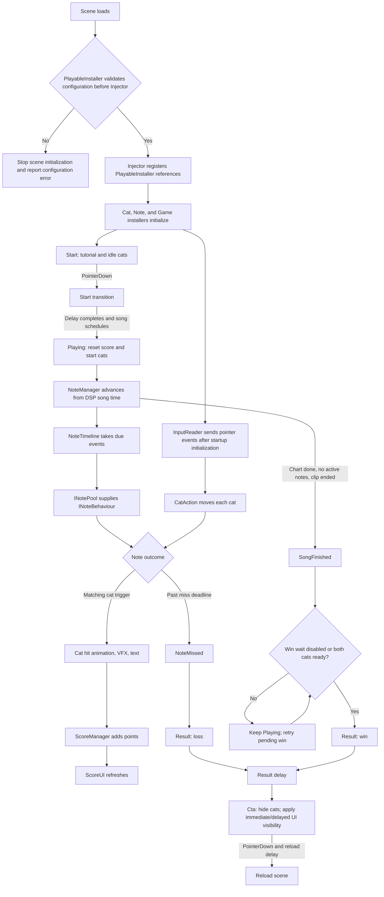

## 1. Scene setup and dependency injection

`PlayableInstaller` holds the scene references, note prefab, `PlayableSettings`, and scene-specific song choices. Its `Awake()` runs at -1100, validates song selection and required references, and caches the selected definition before Injector runs at -1000. Invalid configuration deactivates its scene roots and requests Editor Play Mode exit; in a player the roots stay inactive. Valid configuration lets the unchanged Injector register `[Provide]` results and fill `[Inject]` fields/methods. `PlayableSettings` holds the shared catalog, cat animation set, input asset and nested settings groups.

`InputInstaller` owns input lifecycle. `CatInstaller` builds an action, animation controller and FSM per cat through `ICatSetup`. `NoteInstaller` constructs timeline/pool and passes them to `INoteManager`. `GameInstaller` constructs the game FSM and configures it through `IGameState`. `IInstaller` lifecycle methods are called by each installer's own Awake/Start callbacks. Both game-state and game-host providers return the same GameManager component.

The early root check covers song selection, direct serialized Unity object references on the installer/root settings asset, selected ID resolution and audio/chart presence. JSON contents, prefab physics and Spine clips are checked later by the owning installers. These later failures log and return from system setup; they do not call the root's StopInvalidScene. Injector discovers active MonoBehaviours; it registers all provider results before injecting consumers. It contains property-resolution code, but the current InjectAttribute can be applied only to fields/methods.

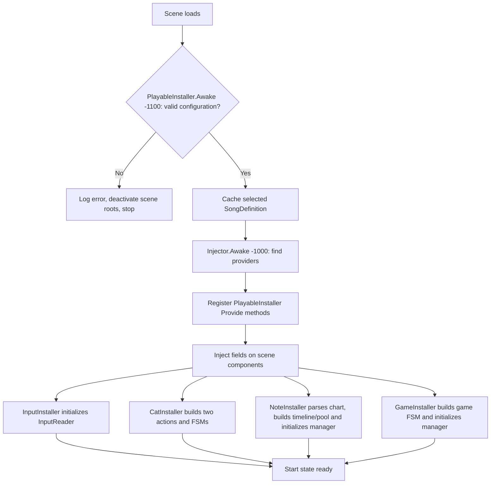

**Applied:** installer/composition-root style and reflection-based dependency injection. `Injector` uses the shared `Singleton<T>` utility; `ScoreManager` is provided as `IScoreManager`.

## 2. Input and cat movement

`InputReader` wraps Unity Input System callbacks as pointer events with stable IDs. Real touch suppresses the emulated mouse input. Each `CatBehaviour` converts screen X to world X and delegates pointer ownership and horizontal clamping to its own plain-C# `CatAction`. Two distinct touches can drag the cats independently. A layout change cancels an active drag.

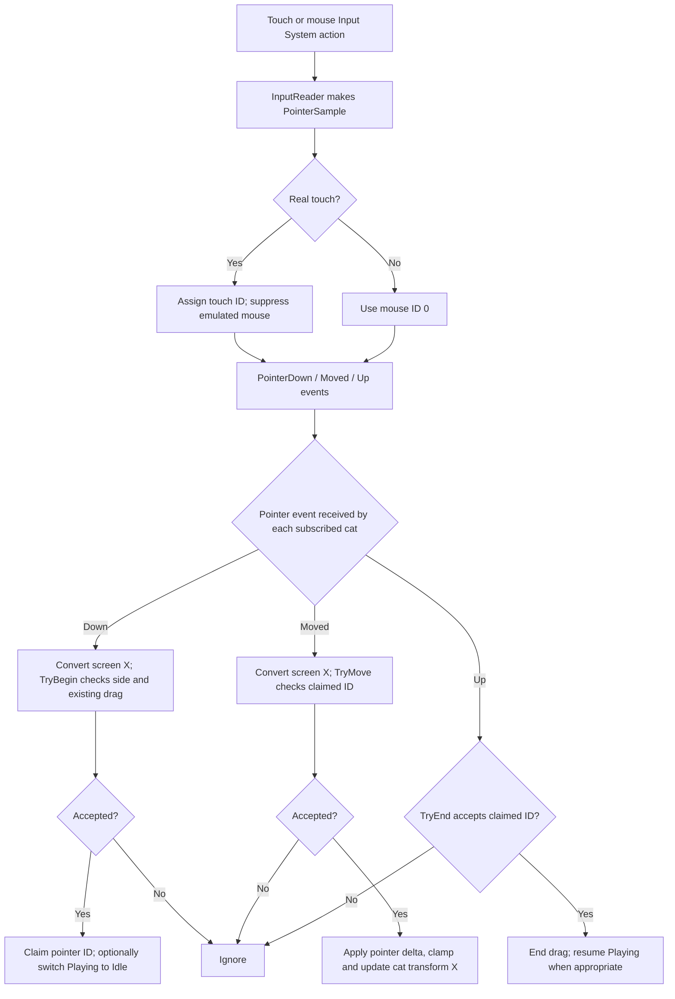

**Applied:** `IInputReader` separates consumers from Unity Input System; C# events distribute input; `ICatAction` separates drag rules from the MonoBehaviour.

## 3. Cat finite state machine and Spine animation

`CatInstaller` resolves `ICatSetup`, validates collider/Spine components and checks the animation asset against each skeleton. It creates one action, `CatAnimationController` and `StateManager<CatState>` per cat. The initial Idle state plays when the FSM is built. The current asset has five idle variants, a Listening loop, hit cues and win/loss loops. States request animations through `ICatAnimation`; the controller selects a clip/loop/mix duration and plays Spine track 0.

A hit enters or replays Hit. Its completion callback marks readiness; CatBehaviour then chooses Playing or Idle from song/drag status. Completion callbacks from replaced animations are ignored. `CanTransition()` is advisory: an explicit FSM transition still happens immediately. GamePlayingState queries both cats before a configured winning Result; a loss can interrupt the current hit.

CatInstaller logs a missing Collider2D without aborting that build; missing SkeletonAnimation or failed clip validation aborts setup for that cat. The saved prefabs contain the expected components.

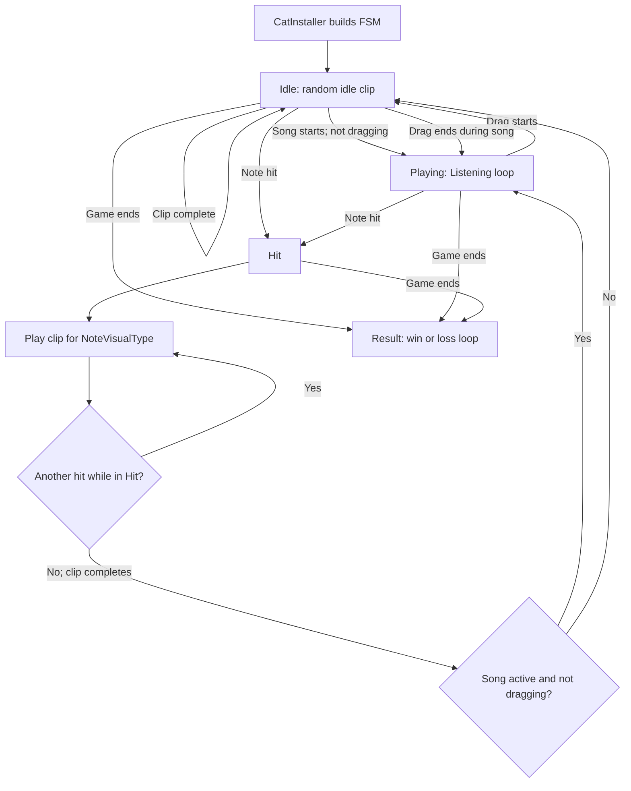

Normal selects one of two single-object clips; Strong, Long and LolipopLong use `Eat_Shot`. Hit cue mix duration is currently 0.03 seconds; other cues use 0.2 seconds. Game and cat states share the generic FSM implementation, with separate machine instances. CatBehaviour ticks with Time.deltaTime; GameManager ticks with Time.unscaledDeltaTime. State completion/input/audio use their own timing mechanisms, so these tick choices alone do not implement a coordinated pause.

StartPlaying ensures input is subscribed without duplicating callbacks. ResetForRun cancels drag, returns an initialized cat to Idle and reconnects active input. This reset hook exists, but the current replay flow reloads the scene.

## 4. Chart, audio clock, and note lifecycle

`NoteInstaller` parses the selected definition's custom JSON (`id`, `spawnTime`, `lane`, `visualType`) through NoteChart, creates NoteTimeline/NotePool once and passes their interfaces into the manager. `NoteManager.Initialize()` configures its AudioSource from `ISongPlaybackSettings`; it does not receive the catalog ID or chart JSON.

StartSong stops previous playback, releases active notes, resets the existing timeline cursor and schedules audio at `AudioSettings.dspTime + 0.1`. FixedUpdate computes songTime from that same DSP origin, removes stale released entries before reuse, takes every due event and updates active notes. A note takes TravelSeconds to move from spawn height to hit height; position continues beyond that height until hit or miss.

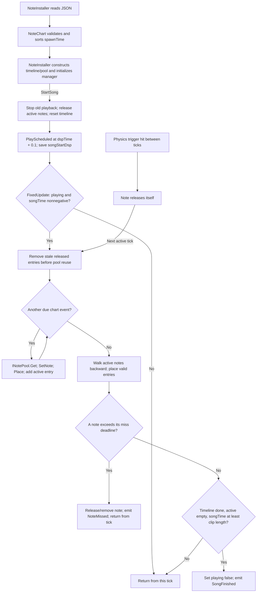

`spawnTime` is the spawn instant; the nominal arrival time is `spawnTime + TravelSeconds`. A trigger can release a note between fixed ticks. NoteManager removes that stale active-list entry at the next active tick, or clears the list when StopSong runs.

Completion compares elapsed DSP song time with AudioClip.length, not AudioSource.isPlaying. SongDefinition.Loop affects audio playback only; it does not rewind/repeat the timeline. A miss is emitted only when songTime is strictly greater than spawnTime + travel + hit window, and that miss ends the current update tick.

## 5. Hit detection and resolution

The note prefab has a kinematic Rigidbody2D and trigger CircleCollider2D. NoteBehaviour first checks HasNote and the layer configured by `INoteSettings.CatLayerName`, then looks up `ICatBehaviour` and checks the side against `lane < 2`. Short-circuit conditions skip component lookup when the layer does not match. A valid hit notifies the cat, awards points and releases the note. Physical overlap produces a hit; HitWindowSeconds sets the miss deadline rather than a Perfect/Good timing grade.

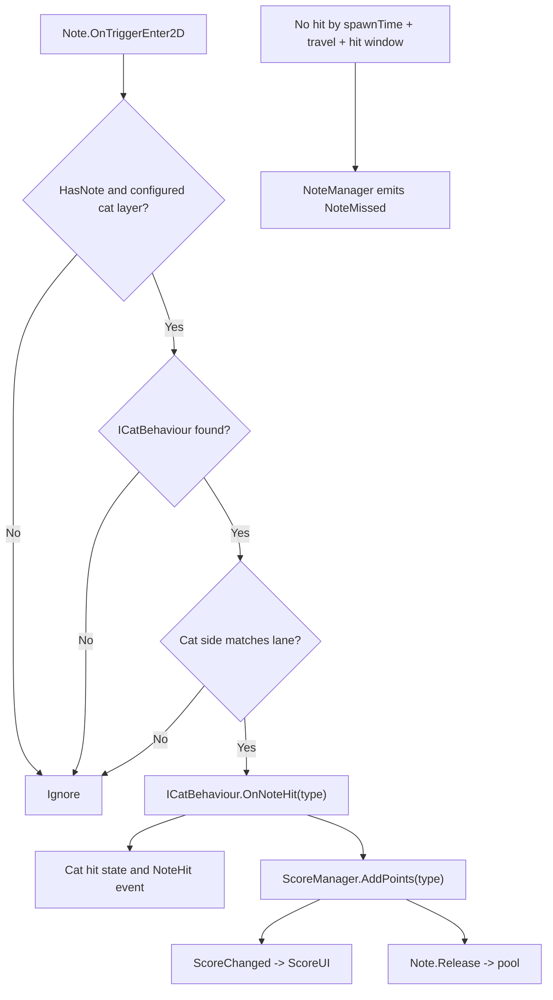

**Applied:** Unity Physics 2D trigger for hit, DSP-time deadline for miss, and events to hand the result to other systems.

## 6. Game session state

`GameInstaller` builds Start, Playing, Result and Cta using the shared StateBuilder/StateManager. GameManager receives that FSM and routes pointer/miss/completion events into the relevant state. State requests go back through IGameHost. FinishRun stores Won before requesting Result, so Result.EnterState reads the new outcome. ChangeState exits/enters the states and then publishes StateChanged.

The first tap starts the tutorial fade. GameStartState waits, schedules the song, then requests Playing. Playing entry resets score and starts cats. A miss finishes a loss immediately unless the Editor-only ignoreMisses flag is set. SongFinished requests a win; when WaitForCatActionsOnWin is enabled, Playing retries until both ICatBehaviour.CanTransition calls succeed. Result stops audio and shows outcome clips, then requests Cta after its delay. Cta hides cats and accepts one reload request.

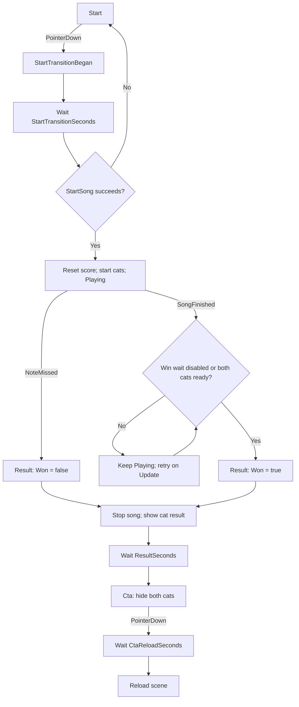

**Applied:** installer-built FSMs, an interface-based state host and C# UI events. StateManager exposes readiness but does not enforce it during TransitionToState; the winning flow owns that decision. Game delays/reload and UI delays use unscaled time. Current settings are Start transition 1.5 seconds, Result 3 seconds and reload 1 second.

## 7. UI state visibility

`GameUIController` listens to `IGameState` and owns each panel's visible states, optional show delay, and Start fade. `GameStateUI` only applies active state, CanvasGroup alpha, and raycast behavior. `ScoreUI` listens to score changes and the Result outcome.

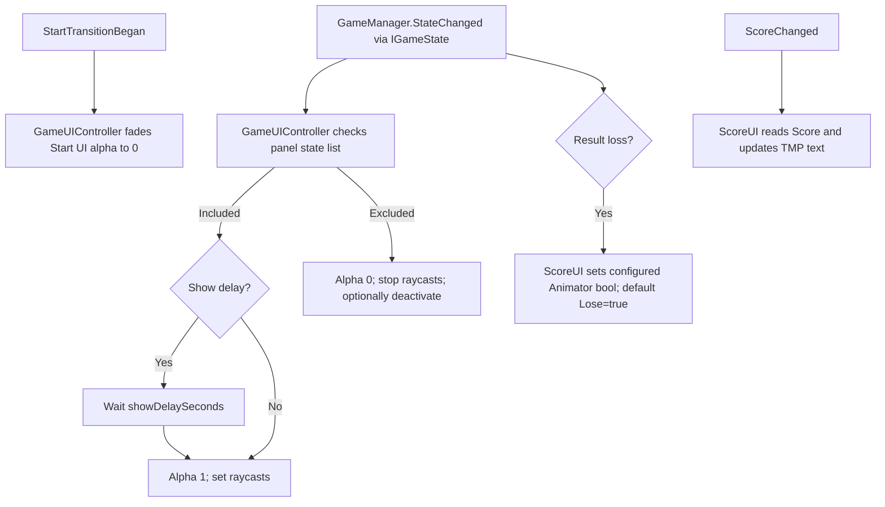

In the playable scene, Start Tutorial is visible in Start; Scores in Playing and Result; Status Panel in Playing and Result after its initial 2-second delay; EndTutorial in Cta; and CTA Panel in Cta after a 3-second delay. A panel shared by Playing/Result preserves its current visibility or ongoing delay. The brown cat prefab has a second controller for its Start-only bubble. Controllers must remain active while their views are hidden so delayed/fade coroutines can run.

## 8. Responsive gameplay, background and UI layout

ViewportController centrally compares Canvas dimensions plus camera pixel rect, aspect, orthographic size and position, and publishes IViewport.Changed when ready/changed. Nonzero Canvas XY world scale is a readiness check rather than a separately cached change signal. ResponsiveLayout selects the profile from viewport orientation, calculates world bounds/lanes/heights from the orthographic camera and places cats. It emits IResponsiveLayout.Changed when calculated LayoutData or camera pixel rect changes; cats cancel their current drag. Note placement reads the latest LayoutData. BackgroundBehaviour listens to the same viewport event, keeps separate portrait and landscape sprites, chooses the orientation sprite and scales its SpriteRenderer uniformly to cover the camera; it has no separate LateUpdate polling loop. This two-image world-space behavior is retained by the 2026-10-20 decision.

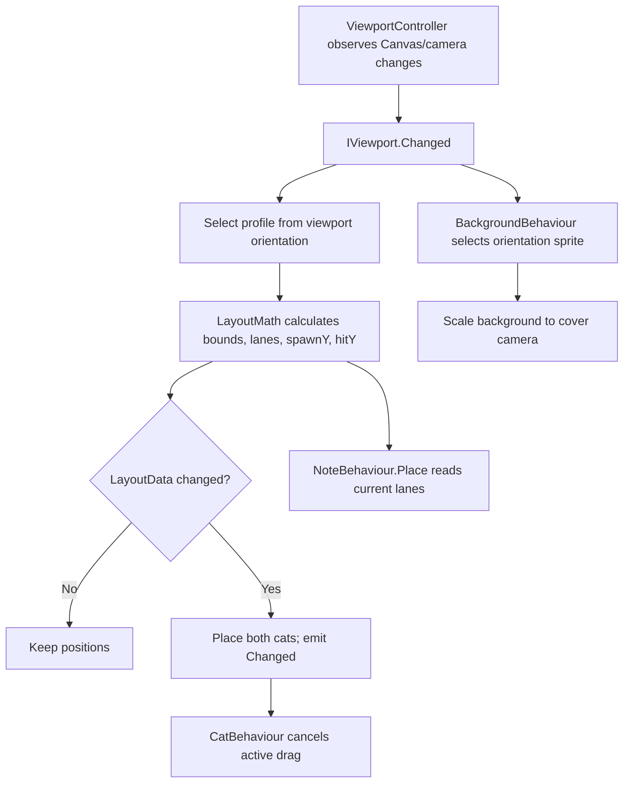

### Built-in UI direction agreed on 2026-10-20

Status and CTA keep their authored composition and child animation. Canvas Scaler uses Scale With Screen Size, reference 1080 x 2280 and **Expand**; authored anchors/pivots/margins keep Status top-right and CTA centered. No Aspect Ratio Fitter is needed on either complete fixed-size group. The target setup disables ResponsiveRectTransform on both; UI layout then needs no custom group-math call or viewport subscription. GameUIController, GameStateUI, ScoreUI and Animator retain visibility, score and animation ownership.

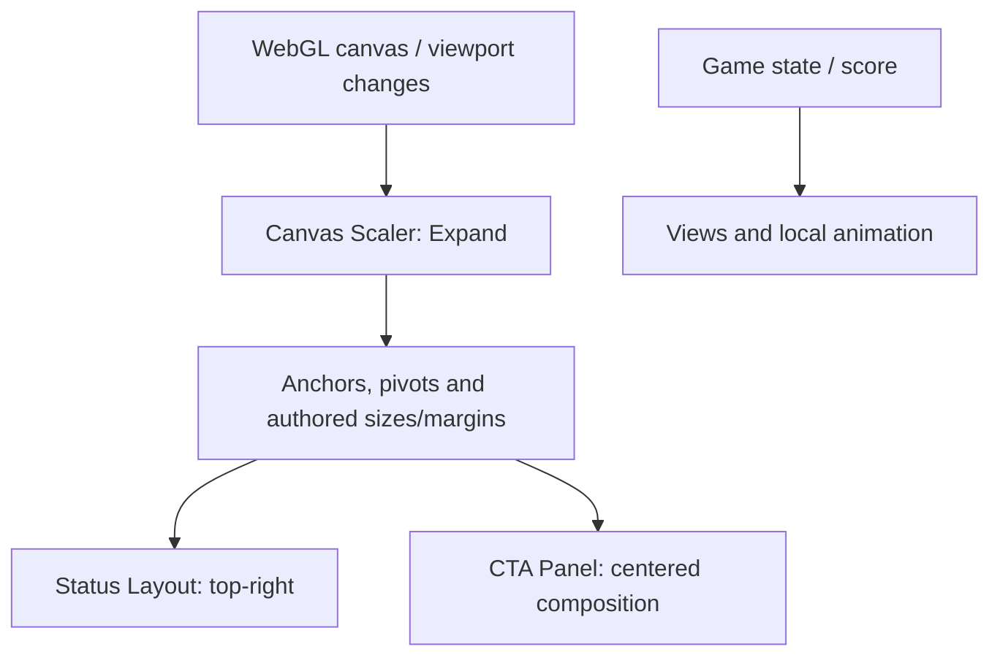

**Saved-scene status:** read-only inspection on 2026-10-20 confirms Expand, CTA ResponsiveRectTransform disabled and Status ResponsiveRectTransform still enabled. The saved scene is therefore only partway through this change. Custom scripts/rules remain; this documentation update does not edit or delete them.

Expand provides uniform fit with extra landscape space; it does not reproduce per-group caps/clamps or rearrange elements into a different landscape design. Animation extents and readability need visual review. For mobile WebGL, the embedding page supplies the game rectangle: do not apply another device inset if the browser already contains it safely. No SafeAreaRoot/bridge or background conversion is introduced by this decision.

### Retained custom UI path

When enabled, ResponsiveRectTransform still listens to IViewport.Changed, reads the parent/Canvas geometry, calls LayoutMath.CalculateUI and applies portrait-baseline rules. Its UI helpers implement visible-area intersection, fitting, scale caps, anchor offsets and full-envelope clamping. These remain source/history details rather than requirements for the selected built-in setup. Previous child consumers, snapshots and CTA variants were removed in earlier refactors; the original portrait clip remains.

See [UI Layout Setup and Retained Calculations](UI_LAYOUT_CALCULATIONS.md) for the decision, exact migration status and earlier equations. The world-space flow above remains required for cats, notes and the two background sprites.

## 9. PlayableSettings configuration

`PlayableSettings` is the root Inspector asset referenced by `PlayableInstaller`. It embeds `NoteSettings`, `HitVfxSettings`, `HitTextSettings`, `GameFlowSettings`, `SceneVisualSettings`, and `ScoreSettings`, and references the separate `SongCatalog`, `CatAnimationSet`, and `InputReader` assets. The installer provides individual settings and assets instead of injecting the root into consumers. Song choices remain per scene; input lifecycle belongs to `InputInstaller`.

In the Editor, choice synchronization runs before selection tracking. When one previously unchecked song ID is checked, `UpdateSongSelection()` clears the other choices. Transient ID history handles catalog reordering; unknown multiple selections and zero selections still go through configuration validation. Playback uses the startup cache, so this authoring behavior does not provide runtime song switching.

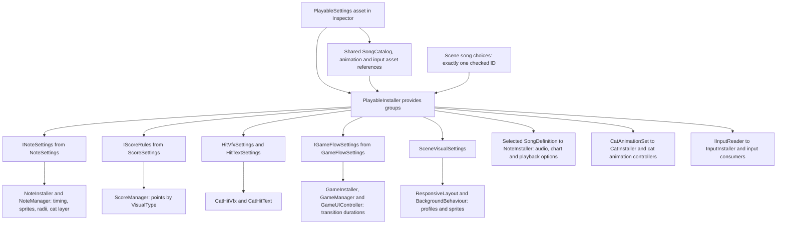

**Applied:** data-driven configuration through a ScriptableObject. The playable uses a simplified custom chart JSON instead of the original chart format.

## 10. Scoring

The scene's ScoreManager is provided as IScoreManager. GameInstaller supplies it to GamePlayingState for reset; NoteInstaller supplies it to NotePool for new note instances; ScoreUI receives it directly. GameManager and NoteManager do not hold a score dependency. ScoreManager's injected IScoreRules supplies per-type points. Reset and AddPoints emit the argument-free ScoreChanged event, so the UI reads the current score. DisallowMultipleComponent prevents duplicates on one GameObject; the provider does not perform a scene-wide duplicate scan.

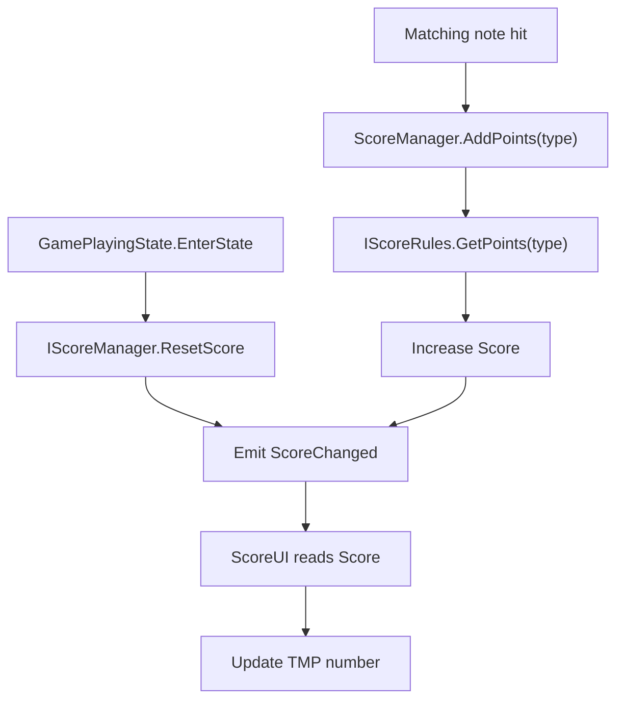

Current points: Normal = 2, Strong = 5, Long = 10, LolipopLong = 10.

## 11. Cat hit feedback and Spine clip mapping

CatBehaviour.OnNoteHit enters/replays Hit and emits NoteHit. CatHitVfx/CatHitText find ICatBehaviour in their parents and subscribe independently. VFX clears the previous burst, applies type-specific lifetime/size/speed/color, changes burst 0 count and plays the prefab's ParticleSystem. Shape/direction are authored in Unity; there is no per-particle angle/velocity loop. LolipopLong uses a random-color gradient. Text reuses a world-space label and rises/fades using unscaled time.

CatHitState calls ICatAnimation. The controller selects a cue/clip, applies destination MixDuration and filters stale completion callbacks. Completion marks CatHitState readiness; CatBehaviour selects its next state during Update.

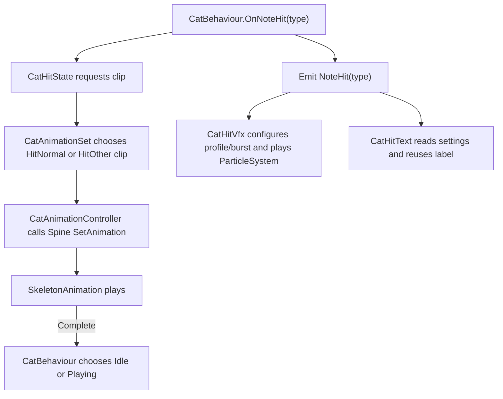

**Applied:** Observer-style events and reusable feedback objects. The hit VFX does not use the note object pool.

## 12. Note object pool

NoteInstaller constructs NotePool using the injected note-parent Transform supplied from the manager's transform, plus score/layer dependencies. NoteManager sees INotePool/INoteBehaviour; NotePool remains the concrete prefab boundary over Pool<NoteBehaviour> and Unity ObjectPool. A first request creates/initializes an instance; later requests reuse inactive ones. ResetForReuse runs before activation. Default capacity/max inactive size are 10; capacity does not create instances in advance, and the inactive limit is not an active-note cap.

Hits call NoteBehaviour.Release directly. Misses/StopSong call INotePool.Release, which checks the concrete pooled type and delegates to that same guarded Release. HasNote prevents a second release. NoteInstaller clears inactive pooled objects on destruction.

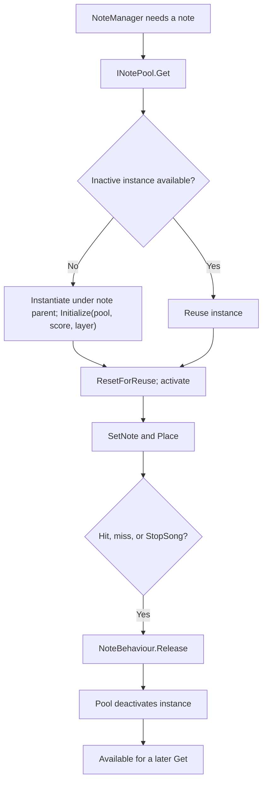

## 13. Scene-authored UI animations

GameUIController decides view visibility; scene Animator/Animation components control local motion. Start Tutorial and the brown cat's Start-only bubble use looping clips. EndTutorial plays its transition at Cta entry. CTA Panel appears after its delay and loops the original CTAState card/finger clip. On loss, ScoreUI sets its configured Status Animator bool, currently Lose=true.

Status Layout and CTA Panel apply responsive transforms at group level. The Status Panel child retains its relative slide animation; CTA children retain animated sizeDelta/position/rotation under the group scale. The former landscape CTA clip/set/variant component and child responsive snapshots have been removed.

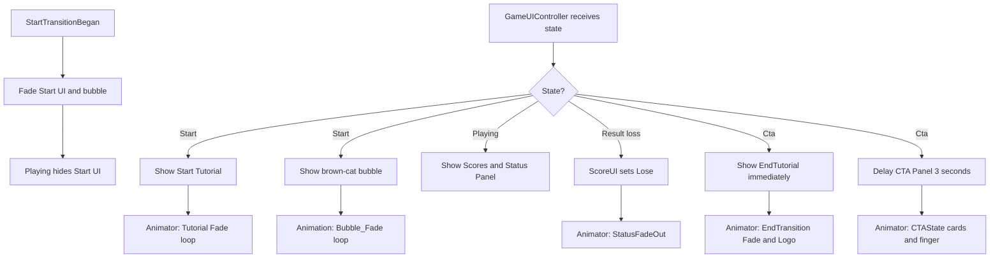

## Scope boundary

NoteManager owns song audio and DSP timing; hit detection is Physics 2D contact with a timed miss deadline. Long/LolipopLong currently remain instant-hit visual types. Song selection is captured at setup, and replay reloads the scene; complete runtime song selection, same-scene replay and coordinated pause are future extensions. Generic utilities such as FadeGraphicComponent, PersistentObject and PrivateSingleton are available in source but are outside the active gameplay paths documented here. Build/hosting are delivery steps outside runtime flow.
