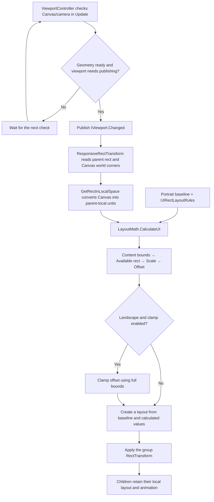

# Responsive UI — Layout Calculations

This guide explains portrait-baseline group layouts on `build/refactor-and-improvement`: calculate scale/offset from current geometry and apply the result to a parent UI group. Read it with [Runtime System Flows](SYSTEM_FLOWS.md) and [File Reference](FILE_REFERENCE.md).

Cross-checked against source commit `33cd662`, the saved scene rules and animation assets. Code excerpts match the current implementation; numeric examples use the actual LayoutMath helper.

## 1. Overview: what the system calculates

UI is first fine-tuned in portrait. When viewport dimensions or orientation change, the system calculates how to place each UI group in the new space. The current scene has two responsive groups: **Status Layout** and **CTA Panel**.

Think of the parent as a table and the content as an object placed on it:

- **Portrait baseline:** the object's authored shape and position.
- **Content bounds:** the rectangle enclosing the content, including its largest animation poses.
- **Available rect:** the usable part of the table after visibility and reserved space are considered.
- **Scale rule:** determines how large the object should be.
- **Position rule:** determines its pivot's offset from the anchor.
- **Clamp:** adjusts position to keep the bounds inside the usable area when possible.

Every result derives from the saved baseline. It does not multiply the previous applied transform, so repeated orientation changes do not accumulate scale.

### How the current rules operate

UIRectLayoutRules is serialized directly on each ResponsiveRectTransform. It stores data; the component supplies that data to LayoutMath:

1. Select a scale mode from IViewport.IsPortrait.
2. Calculate content bounds and the usable parent/Canvas area.
3. Calculate a scale factor and apply its caps.
4. Calculate an offset using the position mode.
5. In landscape, optionally clamp that offset using the full content bounds.
6. Return a layout for the component to apply.

Scale mode has separate portrait/landscape fields, and landscape has an additional scale cap. Position mode, available fractions and content bounds are shared between orientations. Position clamping runs only in landscape.

## 2. Runtime flow and file responsibilities



| File | Responsibility |
| --- | --- |
| `UI/ViewportController.cs` | Cache Canvas/camera, detect changes centrally and publish ready geometry. Orientation uses `canvasHeight > canvasWidth`. |
| `UI/IViewport.cs` | Viewport readiness/orientation and change-event contract. |
| `UI/ResponsiveRectTransform.cs` | Cache scene references, subscribe/unsubscribe, read geometry, call math and apply the group. Includes Editor capture/preview tools. |
| `UI/LayoutMath.cs` | Public static data-in/result-out calculations; its UI helpers do not look up scene components. |
| `Settings/UIRectLayout.cs` | Baseline anchors, pivot, anchored position, sizeDelta, rotation and scale. |
| `Settings/UIRectLayoutRules.cs` | Reference size, enum modes, available fractions, scale caps and content bounds. |

OnEnable also applies the current layout if the viewport is already ready, because a newly enabled group may have missed an earlier event. Editor OnValidate schedules a preview after rules change. Responsive components have no separate Update polling.

The viewport's cached change signals are Canvas size and camera pixel rect, aspect, orthographic size and position. A nonzero Canvas world scale is required for readiness, but its magnitude is not compared as a separate change signal. The callback path does not independently monitor changes to a nested parent. Runtime receives IViewport through injection; Edit Mode preview resolves the controller from the parent hierarchy.

ViewportController waits for positive Canvas dimensions and nonzero XY world scale. Camera pixel dimensions are not a substitute for an uninitialized Canvas rect: pixels and local UI units are different units.

## 3. Inputs and coordinate spaces

### 3.1. Portrait baseline and reference parent

Capture Portrait Layout saves the group's current layout and its parent's dimensions:

```csharp
portrait = Capture();
portraitConfigured = true;
rules.referenceParentSize = _parent.rect.size;
```

`referenceParentSize` is the **parent size in UI units when the baseline was authored**. It can differ from CanvasScaler's reference resolution. The CTA parent adds 100 units of height, so its reference size is `1080 × 2380`; Status uses `1080 × 2280`.

`portraitConfigured` marks a saved baseline as available. Runtime reads that baseline rather than capturing it again on resize.

### 3.2. Comparing Canvas and parent in the same space

The parent's rect is in parent-local space. Canvas corners must be converted into that same space before comparing rectangles:

```csharp
_canvasRect.GetWorldCorners(_canvasCorners);
viewportRect = LayoutMath.GetRectInLocalSpace(
    _canvasCorners, _parent.worldToLocalMatrix);
```

The helper transforms each corner through the supplied matrix, then uses the smallest/largest X/Y to form an enclosing rectangle. The matrix includes hierarchy position, rotation and scale.

For example, if the parent is 50 units above the Canvas, the Canvas center is at Y `-50` in that parent's local space. Comparing the Canvas's own local rect directly would lose that offset.

## 4. Calculation stages in LayoutMath

### 4.1. Parent-size ratios

```csharp
var parentRatio = new Vector2(
    parentRect.width / rules.referenceParentSize.x,
    parentRect.height / rules.referenceParentSize.y);
```

X and Y ratios stay separate. A reference parent of `1000 × 1000` and a current parent of `1600 × 600` produce:

```text
parentRatio = (1600/1000, 600/1000) = (1.6, 0.6)
```

The small examples below share these inputs:

| Input | Value |
| --- | --- |
| Reference parent | `1000 × 1000` |
| Current parent/Canvas | `1600 × 600`, covering the same area |
| Content bounds | `700 × 700` |
| Baseline scale/rotation | `(1,1,1)` / `0°` |
| Baseline anchor/pivot | Top-right `(1,1)` |
| Baseline offset | `(-100,-100)` |
| Available Width/Height | `0.9 / 0.8` |
| Max Scale / Landscape Max Scale | `1 / 1` |

Position examples show values **before clamping** so each enum's calculation is visible.

### 4.2. GetContentBounds: the content envelope

Positive contentBounds width/height select the authored rectangle. It should enclose the content that must fit, including animation peaks. The helper does not traverse children or sample clips; changes to animation/composition may require updated bounds.

Without valid authored bounds, it uses the group's own baseline rectangle:

```text
size = referenceParentSize × (anchorMax − anchorMin) + sizeDelta
rectMin = −size × pivot
```

Fixed anchors have zero anchor span, so size equals sizeDelta. Stretched anchors add a parent-dependent size term.

TransformBounds applies the **group's baseline scale and Z rotation** to all four corners and encloses them:

```text
x' = x × cos(angle) − y × sin(angle)
y' = x × sin(angle) + y × cos(angle)
```

A `100 × 100` square rotated 45° needs an approximately `141.4 × 141.4` envelope. This transforms the group envelope; child animation poses are covered by authored bounds.

### 4.3. GetAvailableRect: usable area and reserved space

First intersect the parent and Canvas, because a parent can extend beyond the visible area. Multiply that intersection's width/height by the rule fractions while keeping its center:

```csharp
private static Rect GetAvailableRect(
    Rect parentRect, Rect viewportRect, UIRectLayoutRules rules)
{
    var visible = Rect.MinMaxRect(
        Mathf.Max(parentRect.xMin, viewportRect.xMin),
        Mathf.Max(parentRect.yMin, viewportRect.yMin),
        Mathf.Min(parentRect.xMax, viewportRect.xMax),
        Mathf.Min(parentRect.yMax, viewportRect.yMax));

    var availableSize = Vector2.Scale(
        visible.size,
        new Vector2(rules.availableWidth, rules.availableHeight));

    return new Rect(
        visible.center - availableSize * 0.5f,
        availableSize);
}
```

There is no separate Margin field. Reserved space is the unused portion of that rectangle:

```text
availableWidth  = visibleWidth  × rules.availableWidth
availableHeight = visibleHeight × rules.availableHeight

Space at each left/right edge = (visibleWidth − availableWidth) / 2
Space at each top/bottom edge = (visibleHeight − availableHeight) / 2
```

With the example inputs:

```text
Available width  = 1600 × 0.9 = 1440 → 80 units at each horizontal edge
Available height =  600 × 0.8 =  480 → 60 units at each vertical edge
```

A fraction of 1 uses the full intersection without reserving additional space on that axis.

### 4.4. UIRectScaleMode: group size

```csharp
public enum UIRectScaleMode { KeepSize, FitParent, FitContent }
```

Portrait Scale Mode and Landscape Scale Mode use the same enum. The active orientation selects one:

```csharp
private static float GetScaleFactor(
    UIRectLayoutRules rules, Vector2 parentRatio,
    Rect bounds, Rect available, bool isPortrait)
{
    var mode = isPortrait ? rules.portraitScaleMode : rules.landscapeScaleMode;
    var factor = 1f;

    if (mode == UIRectScaleMode.FitParent)
        factor = Mathf.Min(parentRatio.x, parentRatio.y);
    else if (mode == UIRectScaleMode.FitContent)
        factor = Mathf.Min(
            available.width / bounds.width,
            available.height / bounds.height);

    factor = Mathf.Max(0f, Mathf.Min(factor, rules.maxScale));
    if (!isPortrait) factor = Mathf.Min(factor, rules.landscapeMaxScale);
    return factor;
}
```

| Option | Calculation before caps | Example | Visible result |
| --- | --- | --- | --- |
| `KeepSize` | `factor = 1` | `700 × 700` remains `700 × 700`. | Retains baseline size; it can exceed the usable area. |
| `FitParent` | `min(parentRatio.x, parentRatio.y)` | `min(1.6,0.6) = 0.6` → `420 × 420`. | Scales the group according to the parent's change from its reference size. |
| `FitContent` | `min(availableWidth/boundsWidth, availableHeight/boundsHeight)` | `min(1440/700,480/700) ≈ 0.6857` → `480 × 480`. | Fits the content envelope into the usable area. |

The smaller ratio is applied to both X/Y to preserve proportions. Factor is relative to baseline scale: baseline XY scale 2 with factor 0.5 produces final XY scale 1.

Caps apply to every mode, including KeepSize. Starting from a raw factor of 0.6857:

- Max Scale 0.5 produces factor 0.5 and example content size `350 × 350`.
- Max Scale 1 and Landscape Max Scale 0.4 produce `280 × 280` in landscape.
- Portrait does not apply Landscape Max Scale.

A cap is a ceiling. Increasing it enlarges content only when that cap was limiting the mode's calculated factor.

### 4.5. UIRectPositionMode: offset from the anchor

```csharp
public enum UIRectPositionMode
{
    KeepAnchorOffset,
    ScaleWithContent,
    RelativeToParent
}
```

AnchoredPosition is an offset from the anchor reference to the group pivot. With a top-right anchor, `(-100,-100)` places the pivot 100 units left and 100 units below the anchor.

```csharp
private static Vector2 GetPositionOffset(
    UIRectLayout portrait, UIRectPositionMode mode,
    Vector2 parentRatio, float factor)
{
    var offset = new Vector2(
        portrait.anchoredPosition.x,
        portrait.anchoredPosition.y);

    if (mode == UIRectPositionMode.ScaleWithContent)
        offset *= factor;
    else if (mode == UIRectPositionMode.RelativeToParent)
        offset = Vector2.Scale(offset, parentRatio);

    return offset;
}
```

Using FitContent factor `480/700 ≈ 0.6857` and parentRatio `(1.6,0.6)`:

| Option | Calculation | New example offset | Visible result |
| --- | --- | --- | --- |
| `KeepAnchorOffset` | Keep the baseline offset. | `(-100,-100)` | Retains its distance from the anchor in UI units. |
| `ScaleWithContent` | Multiply X/Y by the content factor. | Approximately `(-68.57,-68.57)` | Shrinks anchor distance with the content using the same factor. |
| `RelativeToParent` | Multiply X by width ratio and Y by height ratio. | `(-160,-60)` | Maintains anchor distance as a proportion of parent size on each axis. |

These values precede clamping. Changing only Position Mode at the same geometry/scale rules changes offset; the scale calculation does not read Position Mode.

### 4.6. ClampOffset: containing the full bounds

This stage runs only in landscape with Clamp Landscape Position enabled. Resolve the normalized anchor to parent-local coordinates:

```text
anchorFraction = lerp(anchorMin, anchorMax, pivot), separately on X/Y
anchorPosition = parentRect.min + parentRect.size × anchorFraction
pivotPosition  = anchorPosition + offset
```

Fixed anchors resolve to that point. For stretched anchors, the pivot selects the interpolated reference between anchorMin and anchorMax.

For each axis, containing the full envelope requires:

```text
pivot + boundsMin × factor >= availableMin
pivot + boundsMax × factor <= availableMax

pivotMin = availableMin − boundsMin × factor
pivotMax = availableMax − boundsMax × factor
```

One-dimensional example: available interval `0..100`, bounds relative to pivot `-20..20`, factor 1:

```text
pivotMin = 0 − (-20) = 20
pivotMax = 100 − 20 = 80

Requested pivot 90 → clamp to 80.
Content then occupies 60..100, touching the edge.
```

The implementation applies the limits to X/Y, then converts the pivot back into an anchor offset:

```csharp
var position = anchor + offset;
position.x = ClampPosition(
    position.x,
    available.xMin - bounds.xMin * factor,
    available.xMax - bounds.xMax * factor);
position.y = ClampPosition(
    position.y,
    available.yMin - bounds.yMin * factor,
    available.yMax - bounds.yMax * factor);
return position - anchor;
```

If the group is too large, no position may fit both edges. ClampPosition centers the envelope on that axis instead of clamping against reversed limits. It does not reduce scale; size fitting belongs to Scale Mode.

### 4.7. Result creation and application

```csharp
var result = portrait;
result.anchoredPosition = new Vector3(
    offset.x, offset.y, portrait.anchoredPosition.z);
result.scale = new Vector3(
    portrait.scale.x * factor,
    portrait.scale.y * factor,
    portrait.scale.z);
```

Calculation changes XY anchored position and XY scale. Anchors, pivot, sizeDelta, rotation and Z values remain from the baseline. Apply writes the result to the RectTransform carrying the responsive component.

The group transform affects descendants. The component does not iterate over children to modify their properties or keyframes.

## 5. Inspector fields and visible effects

Each row starts from the example inputs in section 4.1 unless specified otherwise. Position examples are before clamp.

| Field | Purpose | Example change and visible effect |
| --- | --- | --- |
| `Reference Parent Size` | Parent comparison baseline and fallback-bounds reference. Capture records it. | Change `1000 × 1000` to `500 × 500`: parentRatio becomes `(3.2,1.2)`. FitParent capped at 1 gives example content `700 × 700`; RelativeToParent gives `(-320,-120)`. This changes the authoring reference and should match the actual baseline. |
| `Portrait Scale Mode` | Selects portrait scaling. | KeepSize → FitParent makes group size depend on parent/reference ratios. Landscape uses its own field. |
| `Landscape Scale Mode` | Selects landscape scaling. | KeepSize → FitParent → FitContent gives example sizes `700`, `420`, `480` on each axis. |
| `Position Mode` | Selects offset behavior in either orientation. | With FitContent, the three options give `(-100,-100)`, `(-68.57,-68.57)`, `(-160,-60)`. |
| `Available Width` | Usable width fraction. | With FitContent, `0.9 → 0.2` reduces available width `1440 → 320`; example content shrinks to `320 × 320`. |
| `Available Height` | Usable height fraction. | With FitContent, `0.8 → 0.5` reduces available height `480 → 300`; example content shrinks to `300 × 300`. |
| `Max Scale` | Factor ceiling in either orientation. | With FitContent, `1 → 0.5` shrinks example content `480 × 480 → 350 × 350`. |
| `Landscape Max Scale` | Additional landscape ceiling. | `1 → 0.4` limits landscape example content to `280 × 280`; portrait does not use this cap. |
| `Clamp Landscape Position` | Position adjustment based on full bounds. | Enabled: requested pivot 90 becomes 80 in section 4.6. Disabled: the Position Mode offset remains even if content extends past the edge. |
| `Content Bounds` | Content envelope in group-local space before baseline transform. | With FitContent, increasing height `700 → 1000` gives factor `480/1000 = 0.48`. Group content shrinks by that factor; the envelope becomes `336 × 480`. Editing bounds does not directly edit child sizeDelta. |

Available fractions affect FitContent scale and landscape clamp limits. They do not directly change FitParent/KeepSize scale. Without landscape clamping, only FitContent uses the available rect to affect the returned layout.

## 6. Animation under a responsive group

```text
CTA Panel                 ← ResponsiveRectTransform controls group scale/position
├── Logo
├── Label
├── Song Cards
│   ├── Song Card 1        ← clip animates sizeDelta
│   └── Song Card 2        ← clip animates sizeDelta
└── Finger                ← clip animates position/rotation/sizeDelta
```

Clips keep writing local properties. The parent group transform maps those local results into the displayed composition.

With uniform group scale 0.75, child scale 1 and CanvasScaler excluded:

| Local animation | Result through the group |
| --- | --- |
| Card size 650 | Corresponding size `650 × 0.75 = 487.5` on that axis. |
| Child moves 100 units | Corresponding movement is 75 units. Final position also includes parent position/rotation. |
| Finger rotates 75° | Remains 75° relative to its parent. Uniform scale does not multiply the angle; parent rotation contributes to final orientation. |

Absolute position cannot be calculated from animatedPosition × factor alone because anchors, parent placement and hierarchy also contribute. Keyframe values remain unchanged while displayed results inherit the group's transform.

The current groups use planar UI with the same factor on X/Y. Child animation bindings remain below the responsive group. A clip writing position/scale on the responsive group itself could overwrite an applied layout.

## 7. Current scene configuration

Saved configuration in `Assets/Scenes/Case Study Scene.unity`:

| Input/rule | Status Layout | CTA Panel |
| --- | --- | --- |
| Reference parent | `1080 × 2280` | `1080 × 2380` |
| Baseline anchor/pivot | `(1,1)` / `(1,1)` | `(0.5,0.5)` / `(0.5,0.5)` |
| Baseline offset | `(-10,-245)` | `(0,-81.5)` |
| Baseline sizeDelta | Approximately `449.6 × 324` | `1066 × 1443.6` |
| Portrait / Landscape Scale Mode | FitParent / FitParent | FitParent / FitContent |
| Position Mode | RelativeToParent | RelativeToParent |
| Available Width / Height | `1 / 1` | `0.99 / 0.9` |
| Max Scale / Landscape Max Scale | `1 / 1` | `1 / 0.7692308` ≈ `500/650` |
| Landscape clamp | Enabled | Enabled |
| Content bounds: minimum, size | `(-449.6,-324)`, `449.6 × 324` | `(-562,-721.8)`, `1095 × 1443.6` |

Status scales with its parent. Its configured bounds cover the stationary visible panel; the child's exit slide deliberately moves beyond that envelope. Landscape CTA bounds include the card animation peaks, and its usable area excludes the parent's off-Canvas extension. CTA retains the portrait composition while scaling the group to available space.

### 7.1. Pixel resolution and Canvas UI units

CanvasScaler currently uses Scale With Screen Size, reference `1080 × 2280` and Match Width Or Height 0.5. For a Canvas covering the viewport, Unity averages ratios in logarithmic space. At match 0.5 this is equivalent to:

```text
canvasScaleFactor = sqrt((pixelWidth/1080) × (pixelHeight/2280))
canvasWidthUI  = pixelWidth / canvasScaleFactor
canvasHeightUI = pixelHeight / canvasScaleFactor
```

Unity CanvasScaler handles this conversion. LayoutMath reads the resulting geometry rather than recalculating CanvasScaler.

A `720 × 1520` screen has the baseline aspect and produces a `1080 × 2280` Canvas in UI units. Fewer pixels do not necessarily change the baseline size in UI units; CanvasScaler determines its displayed pixel size.

### 7.2. CTA example at 1920 × 1080

With this CanvasScaler, Canvas size is approximately `2092.27 × 1176.90` UI units. The CTA parent adds 100 units of height, making it approximately `1276.90` high; the helper still fits against the actual visible Canvas region.

```text
Available width  ≈ 2092.27 × 0.99 = 2071.35
Available height ≈ 1176.90 × 0.9  = 1059.21

Fit factor = min(2071.35/1095, 1059.21/1443.6)
           ≈ 0.73373

Final factor = min(0.73373, 1, 500/650)
             ≈ 0.73373

Card peak after group scale = 650 × 0.73373 ≈ 476.92 UI units
```

CanvasScaler then maps the result to displayed pixels. The 500/650 cap permits a peak up to 500 UI units after group scale; this example needs a smaller value to fit the available height.

## 8. Authoring and inspecting the result

1. Set the viewport to portrait and fine-tune the group/children composition.
2. Capture Portrait Layout to save the baseline and reference parent size.
3. Configure content bounds covering the required composition and animation peaks.
4. Select scale/position modes, available fractions and caps.
5. Editor preview uses the runtime math. Apply Current Layout reapplies manually.
6. When inspecting a rule, hold the other inputs fixed and read the group's Anchored Position/Scale to see which property changes. Position examples here precede clamp; enabling clamp adds the containment step.

Calculation summary: **baseline + current geometry + rules → new scale/offset → group transform → descendant display**.
